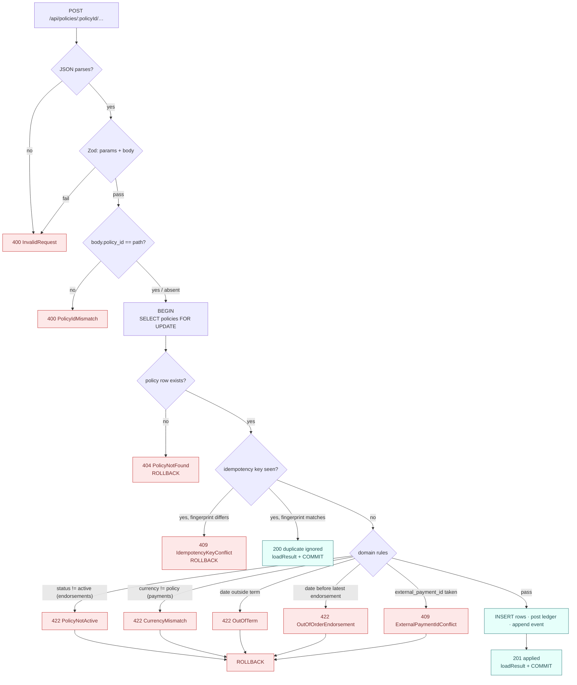
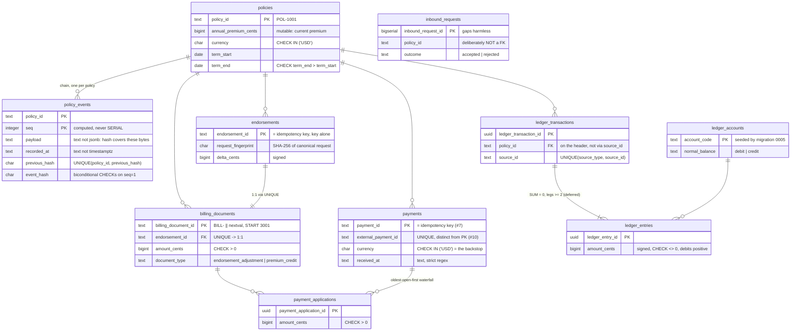
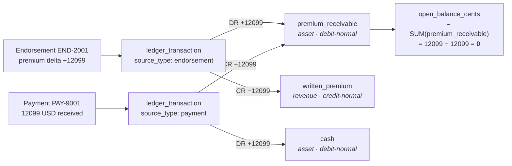
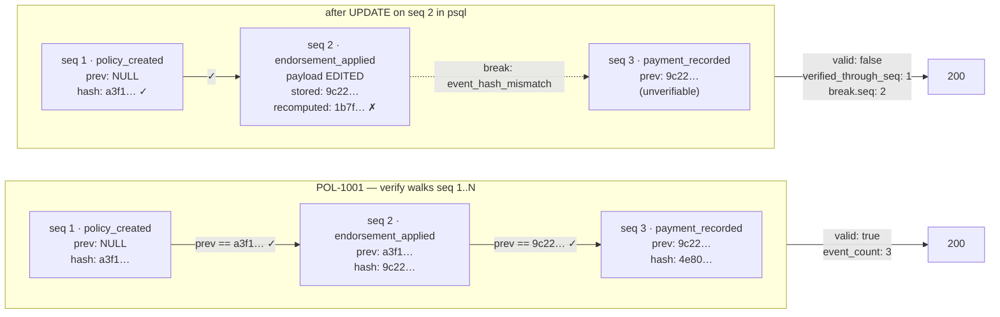

# Policy Ledger Service

[](https://github.com/angelguzmaning/policy-ledger-service/actions/workflows/ci.yml)

A focused slice of a homeowners-insurance Policy Administration System: mid-term endorsement → prorated
premium delta → billing document → received-payment ingestion → balanced double-entry ledger →
hash-chained, append-only policy history, plus a minimal operator UI. Built for Base Labs's Fullstack
Engineer (Backend-Heavy) take-home assessment.

## 1. What this is

The brief's core scenario: a policy (`POL-1001`) can receive a mid-term **endorsement** (a premium change),
which prorates the remaining term into a billing document; a **payment** can arrive against that policy and
settle its open billing documents; every accepted change to the policy is recorded as an immutable event in
a **hash chain**, verifiable on demand; and every dollar moved is posted as a balanced double-entry
**ledger** transaction, provably summing to zero. A minimal operator UI demonstrates the API end to end.

**Scope boundary** — out of scope, deliberately: payment-provider integration of any kind (this ingests
JSON payment data, it does not talk to Stripe/a bank/a gateway); authentication/authorization beyond simple
local assumptions; production deployment/CD; a polished design system; configurable payment allocation or
payments that name their own billing-document target. Full list and reasoning in each decision's rejected
alternatives — see `docs/adr/`.

Domain vocabulary (endorsement, proration, billing document, ledger transaction, hash chain, idempotency
key, …) is defined precisely in [`CONTEXT.md`](CONTEXT.md).

## 2. How to run it

```bash
docker-compose up -d          # Postgres 16
pnpm install --frozen-lockfile
pnpm migrate                  # runs migrations/NNNN_*.sql via scripts/migrate.ts
pnpm db:seed                  # inserts POL-1001 only — scripts/seed.ts
pnpm dev                      # starts the app on :3000
```

In a second shell, once `pnpm dev` is up:

```bash
pnpm replay                   # POSTs events.json through the real HTTP endpoints,
                               # then prints a summary shaped like the brief's Expected Output
```

`pnpm replay` exits non-zero if the printed `ledger.balanced` is `false` or `history.valid` is `false` —
the two properties that actually matter. It is not diffed byte-for-byte against the brief's example; see
[Known limitations](docs/known-limitations.md).

## 3. API design

Six Next.js route handlers under `src/app/api/policies/[policyId]/…`. Full contract, request/response
bodies, and the 23-row test table: [`docs/spec/api-contract.md`](docs/spec/api-contract.md).

**One rule governs the whole error model:** decidable from the request alone → `400`; requires policy
state → `422`. Guard order settles a request's target identity and delivery history before any domain rule
runs:



`idempotency_key` (delivery-retry identity) and `external_payment_id` (the upstream system's own payment
identity) are two distinct `UNIQUE`-constrained identifiers on `payments` — see
[ADR-0006](docs/adr/0006-api-error-model-and-payment-identifiers.md).

## 4. SQL schema

Raw SQL migrations, no ORM — full DDL, transaction boundaries, and the atomicity proof:
[`docs/spec/schema-and-transactions.md`](docs/spec/schema-and-transactions.md).

**The ID rule, stated once:** a primary key is the thing that names the row to whoever has to name it —
caller-supplied natural key where the caller must name it (`policies`, `endorsements`, `payments`;
for the latter two, that key _is_ the idempotency key), server-minted `uuid` where nobody outside the
database names it, composite where position _is_ identity (`policy_events (policy_id, seq)`), `bigserial`
for a gap-tolerant log (`inbound_requests`).



## 5. Business rules

**Proration:** dates are integer epoch-days (never a JS `Date`), arithmetic runs in `BigInt`, rounding is
half-up-away-from-zero (never `Math.round`, which produces `-0` on an exact negative half). See
[ADR-0001](docs/adr/0001-epoch-day-dates-and-hash-the-bytes-you-stored.md). A negative delta becomes a
distinct **premium credit** document rather than a negative charge; a zero delta writes a policy event and
nothing else.

**Ledger posting:** direction is the sign of `amount_cents` (debits positive) — no `CASE` expression
anywhere in schema, service, or API — and balance is enforced by a `DEFERRABLE INITIALLY DEFERRED`
constraint trigger at `COMMIT`, never by application code alone. See
[ADR-0002](docs/adr/0002-ledger-signed-amounts-and-db-enforced-balance.md).



**Idempotency:** the business id (`END-2001`, `PAY-9001`) _is_ the idempotency key — no separate header, no
token table. A stored `request_fingerprint` decides replay (`200 duplicate ignored`) vs. conflict
(`409 IdempotencyKeyConflict`); a rejected request never consumes its key. See
[ADR-0003](docs/adr/0003-business-id-as-idempotency-key.md). Payment settlement follows a deterministic
oldest-open-first waterfall; document status is derived, never stored — see
[ADR-0004](docs/adr/0004-derived-document-status-and-payment-waterfall.md).

## 6. Policy history / hash chain

Every accepted command against a policy (`policy_created`, `endorsement_applied`, `payment_recorded`) is
appended to a per-policy hash chain: each row's `event_hash` covers every other column, including
`previous_hash`. `GET /policies/:id/history/verify` rehashes the whole chain and reports `valid: true`, or
`valid: false` with the first break localized. Full design, canonicalization rule, and rejection-logging
design: [ADR-0005](docs/adr/0005-hash-chain-design.md).



`policy_created` is included in the chain against the brief's own sample (`event_count: 3`, not 2) so the
premium baseline is itself hash-covered rather than trusted from a mutable row — the `events` type list in
every response makes the difference explain itself on sight.

## 7. Frontend

A single-page "split console" operator UI for `POL-1001`: status bar (premium, term, open balance, history
verified pill), a merged timeline of events/documents/payments, a ledger panel showing `account_balances`
and the always-empty `unbalanced_transactions` probe, and two forms (apply endorsement, record payment)
built on TanStack Query `useMutation` with invalidate-and-refetch as the demonstration of API consumption.
Full scope, rejected layout alternatives, and the demo path:
[`docs/spec/frontend-ui.md`](docs/spec/frontend-ui.md).

## 8. Tests & CI

Unit tests cover the pure domain core (proration, canonicalization/hashing, chain verification, ledger
entry construction, the payment waterfall, the explanation/suggested-action rules, Zod schemas,
`toHttpResponse`). Integration tests cover the four DB-backed areas the brief requires: duplicate delivery,
wrong-currency rollback (with a whole-database atomicity proof), balanced ledger writes, and history
verification (including a test that tampering itself requires disabling the append-only trigger first).
**No test boots Next** — a route handler is three statements, each covered elsewhere. 143 tests (unit +
integration) pass locally against a real Postgres. Coverage is measured every run
(`coverage.include: ['src/server/**']`) and never gated by a threshold — a stated position, not a silent
gap; the number this build actually achieves is **84.6% statements / 82.4% branches / 87.2% functions /
86.4% lines** (`pnpm test:coverage`). The two files sitting near 0% by design are `src/server/api/http.ts`
and `writeHandler.ts` — the route-assembly layer the "no test boots Next" rule deliberately leaves
untested, held to a handful of lines each so the gap stays reviewable. One CI job, cheapest-first
(`install → format:check → lint → typecheck → test:coverage → build → audit`), against a real Postgres
service container. `pnpm audit` blocks at `critical`, reports at `high` (four known `next`-pinned
build-time advisories, non-blocking by necessity). Full test list and workflow YAML:
[`docs/spec/test-plan-and-ci.md`](docs/spec/test-plan-and-ci.md).

## 9. On-call: monitor & recover

**Watch / alert on:**

1. `unbalanced_transactions` non-empty (the probe `GET /ledger` exposes) — structurally impossible given
   the deferred DB trigger, so any hit means the trigger was bypassed or disabled. **Page immediately.**
2. Any `history/verify` returning `valid: false` — the response localizes the first break (`seq`, reason,
   expected vs. stored). **Page**, with the returned break point attached.
3. `inbound_requests` rejection rate (payment/endorsement 4xx spike) — most rejections are expected (e.g.
   an EUR mismatch), so this is a **rate/trend alert**, not page-on-first-occurrence.
4. Any `500` from the API — per the error-translation rule, a 500 here specifically means an application
   bug, never expected in normal operation. **Page.**
5. `IdempotencyKeyConflict` (409) rate — a spike suggests a caller reusing keys across different payloads;
   worth investigating, not paging on.

**Recovery, given append-only / no in-place edits:** a bad ledger or policy-event write can't be edited —
recovery is always **appending a correcting event/transaction**, never `UPDATE`/`DELETE` (blocked by the
append-only trigger regardless). A broken hash chain is **not auto-repairable**: identify the break point
via `verify`, treat rows from that point on as untrusted, restore from backup/WAL if it's corruption, or
escalate as a security incident if it's tampering — the resolution itself becomes a new recorded event, not
a silent fix. No automatic rollback/retry logic exists, so recovery is always a human-initiated, explicit
follow-up action.

## 10. Where AI was used

I used an AI coding assistant to explore the design space (schema shape, idempotency contract, hash-chain
canonicalization, ledger balance enforcement) and to generate the first draft of each layer — migrations,
service layer, tests, UI — from the agreed design.

What I verified manually: every migration, run and inspected; every test, read and run green locally; the
hash-chain canonicalization, hand-checked against `sha256sum` on a real row; the replay script, run
end-to-end against the seeded database with its output compared to the brief's example by eye; the
rounding rule's edge cases (negative-exact-half, leap-year term), traced by hand.

This is not a rejection of the client's AI thesis; it's a statement of where an LLM does and doesn't sit in
this system. `explanation` and `suggested_action` are rule-based, not model-generated — no non-determinism
between the ledger and the operator reading it. An LLM belongs in drafting the insured-facing dunning
message or triaging the rejected-request queue, not in producing a number a financial summary depends on.

## 11. What I'd improve with more time

1. **Two-client contention test** — the lock's shape is proven deterministically elsewhere; a real
   concurrent-request test would close the gap entirely.
2. **Frontend test coverage** — zero today; `coverage.include` is scoped to `src/server/**` deliberately,
   stated honestly rather than padded.
3. **Richer payment allocation** — oldest-open-first waterfall is the stated default; remittance-advice-style
   payments targeting a specific billing document, or a configurable allocation policy, is real-world work
   the brief's payload shape doesn't ask for.
4. **CI fan-out / faster pipeline** — a single cheapest-first job is right-sized for a 6-hour build; a
   longer-lived project would split lint/test/build once the suite grows.
5. **`pnpm audit` high-severity noise** — currently all `next`'s own pinned build-time deps, non-blocking
   by necessity; a longer-lived project would track and bump `next` on a cadence to keep that list zero.

## 12. Known limitations

Every decision's known limitations are indexed, one line each, in
[`docs/known-limitations.md`](docs/known-limitations.md), each row linking back to the ADR or spec doc
that states it in full.
