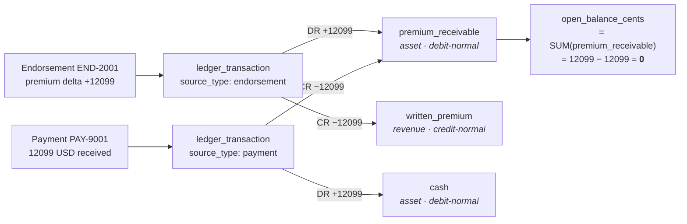
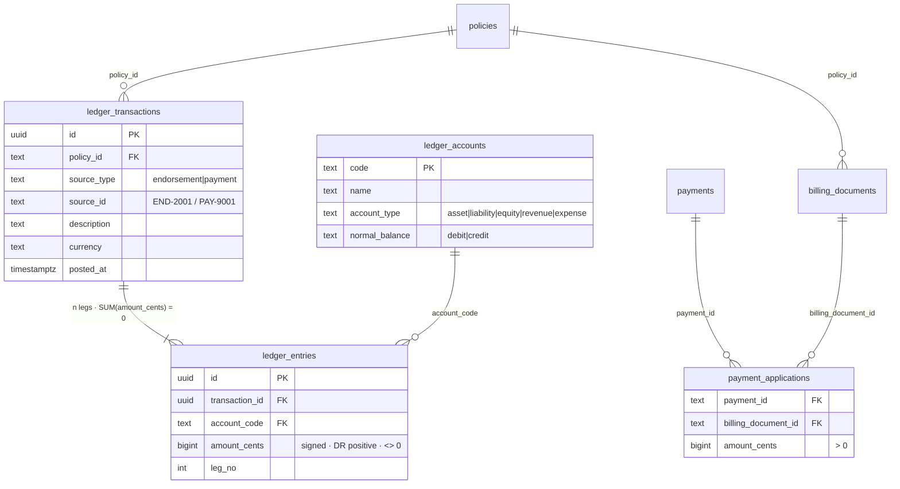

# 0002: Signed `amount_cents` over a `direction` column; DB-enforced deferred balance trigger

## Status

Accepted. Source: [#6](https://github.com/angelguzmaning/policy-ledger-service/issues/6) (ledger model,
chart of accounts, and where balance is enforced).

## Context

The ledger must implement real double-entry bookkeeping: every transaction's legs sum to zero, every
transaction has at least two legs, and a negative endorsement delta must post through the _same_ code path
as a positive one rather than a parallel branch. Two decisions were contested: how a leg's direction
(debit vs. credit) is represented, and where "this transaction balances" is actually enforced.

## Decision

### Direction is the sign of `amount_cents`

`ledger_entries.amount_cents` is a signed `bigint` (`CHECK (amount_cents <> 0)`) — debits positive, credits
negative. The balance invariant is exactly `SUM(amount_cents) = 0` per transaction, and an account's
balance is exactly `SUM(amount_cents)` over its entries. **No `CASE` expression exists anywhere in schema,
service, or API** — a positive number always means debit, everywhere, so there is no site where a sign
could be inverted by a copy-paste of a `CASE WHEN direction = 'debit' THEN amount ELSE -amount END`.

A negative endorsement delta (a **premium credit**) posts through the identical builder as a positive one,
with signs reversed — DR Written Premium / CR Premium Receivable — so written premium is held **net**
rather than routed through a separate contra-revenue account. One code path, both signs.

`ledger_transactions ||--|{ ledger_entries` is deliberately **one-to-many, not one-to-two**: arity is
unconstrained (a future split payment adds legs, not a migration), balance is enforced separately from
shape.

### Balance is enforced by the database, not by the service layer

A `DEFERRABLE INITIALLY DEFERRED` constraint trigger (`assert_transaction_balanced`) fires once per
`ledger_transaction_id` **at `COMMIT`**, checking `SUM(amount_cents) = 0 AND COUNT(*) >= 2`. Deferral is
load-bearing: legs are inserted one row at a time, so an _immediate_ trigger would reject every valid write
partway through. Because the check runs at commit, the service can insert legs in any order and the
transaction stands or falls as a whole.

The reasoning this survives on: **a database transaction gives atomicity, not correctness.** A sign error
or a rounding bug commits atomically and _wrongly_ — `BEGIN`/`COMMIT` guarantees all-or-nothing, not
zero-sum. `CHECK` constraints are per-row and structurally cannot express a cross-row `SUM`, which is why
this needed a trigger rather than a `CHECK (amount_cents ...)` clause.

`GET /ledger` then **proves** balance rather than asserting it: `account_balances`, `sum_all_entries`, and
an `unbalanced_transactions` probe (`GROUP BY ledger_transaction_id HAVING SUM(amount_cents) <> 0`) that is
always empty _by construction_, given the trigger — the on-call note (README) points at this exact query
as the first thing to run at 3am.

## Rejected alternatives

- **A `direction` enum/boolean column (`'debit' | 'credit'`) alongside an unsigned `amount_cents`.**
  Rejected because it requires a `CASE` at every site that reads or aggregates an amount — the schema, the
  service, and the API each need their own translation, and each is a distinct chance to invert a sign.
  The signed-amount design collapses "what is this leg's direction" into "read the sign," a fact the
  database can already sum.
- **Service-level assertion of balance** (compute the sum of legs in TypeScript before `INSERT`ing, throw
  if non-zero). Rejected on the same "atomicity is not correctness" reasoning: a service-level check only
  catches a bug in the code path that remembers to call it. A raw `INSERT` from a script, a future
  maintenance query, or a code path that forgets the check would commit an unbalanced transaction silently.
  Only a database-level guarantee holds regardless of which code wrote the rows.
- **`CHECK` constraint instead of a trigger.** Rejected as structurally impossible: `CHECK` is evaluated
  per row against that row's own columns, and cannot see the other legs of the same transaction to sum
  them.
- **Contra-revenue `return_premium` account for negative deltas**, instead of mirroring the same two
  accounts. Named as the production-scale road not taken: a real general ledger would likely want gross
  written premium and gross returns as separate lines for reporting. Rejected here because it doubles the
  account set and the posting logic for a distinction the brief's scope has no consumer for; net written
  premium is simpler and the one-code-path-both-signs property is worth more at this scale than the
  gross/net split.

## Known limitations

**Written premium is held net, not as contra-revenue.** A negative endorsement reduces the same
`written_premium` balance a positive one increased, rather than accumulating in a separate returns line.
_How you would notice:_ a reporting requirement asking for gross written premium vs. gross returns
separately would find only the net figure in this schema. _What you would do:_ add a `return_premium`
account and route negative deltas there instead of mirroring — a migration, not a redesign, since the
posting builder already isolates "which accounts, which signs" in one function.

**Oldest-open-first payment allocation is a stated default, not a configurable policy** (see ADR-0004 for
the full reasoning) — noted here because it is this ADR's ledger that the waterfall writes into.

**The deferred trigger is droppable by the table owner**, and migrations run as owner — see ADR-0005's
identical limitation on the append-only trigger for the general shape of this risk and its mitigation.
