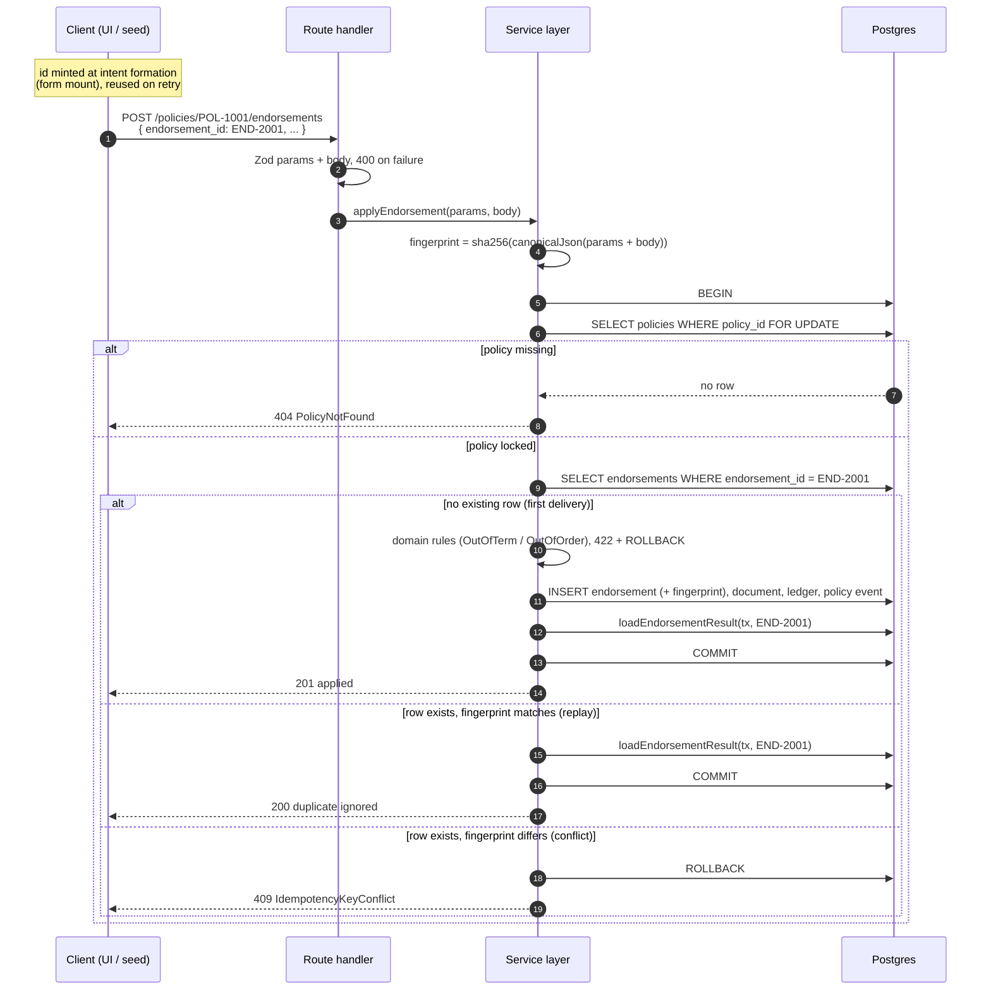

# 0003: The business id is the idempotency key — no token table

## Status

Accepted. Source: [#7](https://github.com/angelguzmaning/policy-ledger-service/issues/7) (idempotency
contract for endorsements and payment ingestion).

## Context

Both write endpoints must be safe to retry: a client that times out waiting for a response, or double-taps
a submit button, must not create two endorsements or double-apply a payment. The brief's own sample data
(`END-2001` and `PAY-9001` both appear twice in `events.json`) makes this a scored path, not a hypothetical
one.

## Decision

**The business id is the idempotency key.** `END-2001` / `PAY-9001` arrive in the request body as
`idempotency_key` (never a separate `Idempotency-Key` header), and idempotency is enforced by a plain
`UNIQUE` constraint on the domain row — no token concept, no `idempotency_keys` table, no separate
"reserve a key" endpoint.

Uniqueness is on **the key alone**, not `(policy_id, key)`. A retry accidentally misrouted to a different
policy therefore **conflicts** rather than silently creating a second endorsement under the wrong policy —
the composite form would have let that through.

The key is **always caller-supplied, never server-generated and never optional**, validated as an opaque
bounded string (`/^[A-Za-z0-9_-]{1,64}$/`) rather than a house format, so both the brief's seed ids and a
UI-minted UUID are legal.

"Same payload" is decided by a stored `request_fingerprint CHAR(64)` — SHA-256 over the canonical JSON of
the **validated** path params plus validated body (shared with the hash chain's canonicalizer — one
primitive, two jobs, per ADR-0005). The path `policy_id` is part of the preimage specifically so a retry
aimed at the wrong policy fingerprints differently and conflicts rather than replaying as success.

Guard order is `400 InvalidRequest` → `404 PolicyNotFound` → idempotency lookup → `422`s, so the target's
identity is settled before request history is consulted. Outcomes are `201 "applied"` / `200 "duplicate
ignored"` / `409 IdempotencyKeyConflict` — no `result` field appears on the error envelope.

**Replay is a projection, not a snapshot.** One `loadEndorsementResult(tx, id)` function runs inside the
transaction and serves both the create path and the replay path, so the two responses are identical by
construction rather than by two code paths agreeing to stay in sync.

**A rejected request never consumes its key.** It rolls back, so `PAY-9002` submitted in EUR fails and the
same id resubmitted in USD succeeds. This falls directly out of transactional atomicity rather than being a
separate rule to remember.

Concurrency is settled by the per-policy `SELECT ... FOR UPDATE` as the transaction's **first statement** —
one mechanism serving three jobs across this ADR, the hash-chain fork prevention (ADR-0005), and the
endorsement-ordering check (ADR-0001's proration). The `UNIQUE` index is the backstop; no `23505` is ever
surfaced to the caller — a concurrent insert re-reads under the lock and resolves as duplicate or conflict.

**The key is minted at intent formation, not at submit.** In the UI, `useState(() => crypto.randomUUID())`
runs at form mount, not inside the submit handler. Minting on click instead of on mount means a double-click
mints two distinct keys and idempotency has protected nothing — this is a correctness rule about *when* the
key is generated, not merely *that* one exists.

## Rejected alternatives

- **A `idempotency_keys` token table**, with a server-issued token the client must fetch before the real
  request. Rejected because the client must still hold *some* identifier across a retry regardless of who
  minted it — server pre-issuance buys an extra endpoint and an extra round trip and solves nothing that
  caller-supplied ids don't already solve. It also doesn't match the brief's data: `events.json`'s records
  already carry natural business ids.
- **`Idempotency-Key` as an HTTP header**, separate from the business id. Rejected because it introduces a
  second identifier to keep in sync with the business id (`END-2001` the header vs. `END-2001` the
  endorsement) for no benefit — the two would always be set to the same value in practice, so the header
  is a formality around a fact already present in the body.
- **`UNIQUE (policy_id, idempotency_key)`** instead of `UNIQUE (idempotency_key)` alone. Rejected because
  it lets a key collide across policies — a client bug that sends `END-2001` to the wrong policy would
  create a second, distinct endorsement rather than conflicting, which is the one failure mode a shared
  key namespace exists to prevent.
- **A retry loop under `SERIALIZABLE` isolation.** Considered and rejected alongside the locking decision
  in ADR-0005/schema-and-transactions.md: correct, but adds retry plumbing to every write path and a
  hazard where a retry re-burns the billing-document sequence and can double-write `inbound_requests` — see
  that document's transaction-boundary section.

## Known limitations

**Uniqueness is on the key alone, which is a narrower namespace than `(policy_id, key)`.** If two entirely
unrelated upstream systems both happen to mint `END-2001`, the second is rejected as a conflict rather than
accepted as a coincidence. _How you would notice:_ a `409 IdempotencyKeyConflict` on a request the caller
believes is genuinely new. _What you would do:_ this is accepted deliberately — see the rejected
alternative above — because the failure mode it prevents (misrouted retry silently duplicating) is worse
than the failure mode it risks (two independent systems colliding on a business id, which is itself a
naming-discipline problem upstream).

**The opaque key format (`/^[A-Za-z0-9_-]{1,64}$/`) accepts any caller-chosen scheme**, including
adversarial ones designed to collide with a legitimate future id. _How you would notice:_ a caller
deliberately reusing another integration's id space. _What you would do:_ out of scope for this build —
authentication/authorization is explicitly out of scope on the map, and a real deployment would scope keys
per authenticated caller.
