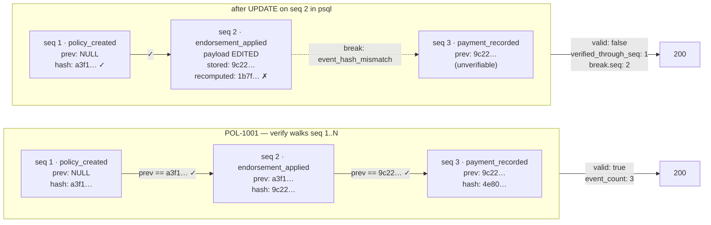

# 0005: Hash chain design — canonicalization, genesis, scope, and rejection logging

## Status

Accepted. Source: [#8](https://github.com/angelguzmaning/policy-ledger-service/issues/8) (policy event
hash chain and history verification). Inherits the shared append-only trigger settled in
[#6](https://github.com/angelguzmaning/policy-ledger-service/issues/6).

## Context

The brief requires policy history to be "traceable and safe" — an append-only, tamper-evident record.
Several sub-decisions had to be made together because they interact: how much of the JSON canonicalization
problem to solve, what a chain's genesis looks like, whether chains span policies, whether the chain
includes the policy's original creation, and what happens to a request the system refuses.

## Decision

### One chain per policy

Each policy's events form an independent hash chain; `POL-1001` seq 1 links to nothing, `POL-2002` seq 1
links to nothing. `previous_hash IS NULL` is genesis, enforced by two biconditional `CHECK`s so a spliced
chain head fails a **constraint**, not merely a verification pass:

```sql
CHECK ((seq = 1) = (previous_hash IS NULL)),
CHECK ((seq = 1) = (event_type = 'policy_created'))
```

`PRIMARY KEY (policy_id, seq)` plus `UNIQUE (policy_id, previous_hash)` make a fork structurally
impossible — the unique index stops two rows claiming the same parent, and Postgres treats `NULL`s as
distinct so it does not constrain the (single, PK-guarded) genesis row.

### Canonicalization is a ~30-line rule, not RFC 8785

```ts
// Accepts: string | integer number | boolean | null | plain object | array
export function canonicalJson(value: unknown): string {
  if (value === null) return 'null'
  if (typeof value === 'string') return JSON.stringify(value)
  if (typeof value === 'boolean') return value ? 'true' : 'false'
  if (typeof value === 'number') {
    if (!Number.isSafeInteger(value)) throw new Error('non-integer in canonical payload')
    return String(value)
  }
  if (Array.isArray(value)) return `[${value.map(canonicalJson).join(',')}]`
  if (typeof value === 'object' && Object.getPrototypeOf(value) === Object.prototype) {
    return `{${Object.keys(value)
      .sort()
      .map((k) => `${JSON.stringify(k)}:${canonicalJson((value as Record<string, unknown>)[k])}`)
      .join(',')}}`
  }
  throw new Error('unserializable value in canonical payload')
}
```

Sorted keys, no whitespace, bare integers, `JSON.stringify` string escaping. **The `throw` is the
guarantee** — not "we hope a float doesn't sneak in" but "a float cannot be hashed," because
`Number.isSafeInteger` rejects `1.5`, `NaN`, `Infinity`, and anything past `2^53`. Re-implementable from
one paragraph, which is what "reproducible years later" actually requires — a reviewer in Python or Go can
write an equivalent in ten minutes without needing our npm tree. Shared verbatim with ADR-0003's request
fingerprint — one primitive, two jobs.

### Preimage — every column except `event_hash`

```json
{
  "hash_version": 1,
  "policy_id": "POL-1001",
  "seq": 2,
  "event_type": "endorsement_applied",
  "recorded_at": "2026-08-01T12:00:00.000Z",
  "payload": {
    "endorsement_id": "END-2001",
    "effective_date": "2026-07-01",
    "premium_delta_cents": 12099
  },
  "previous_hash": "a3f1…"
}
```

`event_hash = sha256(utf8(canonicalJson(preimage)))`, lowercase hex. Stated as a checkable invariant: any
column left out of the preimage is a license to edit it undetected, so the preimage builder can be read
next to the `CREATE TABLE` and every column should be present. `hash_version` exists so the scheme can
rotate — a migration that _rewrites_ historical hashes instead of versioning them silently destroys the
evidence (see Known limitations). `recorded_at` is `TEXT`, not `timestamptz` — see ADR-0001, which states
the general rule this specific choice is an instance of.

### Three event types, at accepted-command granularity

`policy_created` (seq 1, always), `endorsement_applied`, `payment_recorded` — one event per accepted
command, not per side-effect row. The chain records decisions; the ledger records their arithmetic.

**`policy_created` is included, against the brief's own sample** (which shows `event_count: 2` for one
endorsement plus one payment, implying no genesis event). Included because it makes the chain
**self-sufficient**: without it, `term_start`, `term_end`, and the original premium live only in the
mutable `policies` row, so the chain would protect every step of the arithmetic _except its starting
point_ — editing `term_end` directly would leave every historical proration wrong while `verify` still
returned `valid: true`. With it, the current premium is recomputable from event 1 forward and compared
against the `policies` row as an independent check. The cost — `event_count` reads 3 where the brief's
example shows 2 — is mitigated by returning the event-type list alongside the count, so the difference
explains itself on sight.

### Sequencing under concurrency

`seq` is **computed**, never a database sequence, under the same per-policy `SELECT ... FOR UPDATE` that
guards idempotency (ADR-0003) — one mechanism, four jobs (that race, this chain's fork prevention, the
proration ordering check, and the tip read). A `SERIAL`/sequence is not transactional: a rolled-back
transaction still consumes its number, and a gap left behind is indistinguishable from a deleted event —
exactly the thing gaplessness exists to make detectable.

### Append-only, shared trigger, no `TRUNCATE` guard

`policy_events` carries the identical `BEFORE UPDATE OR DELETE` trigger used by `ledger_transactions`,
`ledger_entries`, and `payment_applications` (one shared function, four call sites, no per-table variation
to drift). Deliberately **no `TRUNCATE` guard** — the test harness depends on `TRUNCATE ... RESTART
IDENTITY CASCADE` between tests, and a control routinely disabled protects nothing while costing the reader
an explanation.

### Verification

`GET /policies/:id/history/verify` rehashes through the **same** `canonicalJson` and preimage builder the
writer uses — one implementation, so write and verify cannot drift apart. The obvious risk (a
canonicalizer bug is invisible because both sides agree) is answered by a **golden-vector test**: a
hardcoded preimage string and its externally-computed SHA-256, pinned in the suite — a change to the
canonicalizer's behavior fails that test even though write and verify still agree with each other.

`200` whenever verification ran; `valid: false` is a correct answer, not a server failure. The **first**
break only is reported, localized (`seq`, one of four reasons, expected vs. stored hash), with
`verified_through_seq` telling the operator how much history is still provably intact — the difference
between an alarm and a diagnosis.



This diagram doubles as the video's tamper demo: `psql` `UPDATE` on a historical event is **blocked by the
trigger**; the demonstrator disables it, edits the row, re-enables it, then hits `GET /history/verify` and
sees `valid: false` with the break localized to the exact sequence number. Control and evidence, in one
clip.

### Rejections are logged, not chained

A request the service refuses (e.g. `PAY-9002` in EUR) is **not** written to `policy_events` — the policy
was not affected, so the chain stays a record of what happened _to the policy_. But it is written to
`inbound_requests`, an append-only-log-shaped table (no append-only trigger of its own; it is a receipt
log, not part of the auditable financial core) on a **separate database connection outside the business
transaction**, so the rollback that protects the ledger cannot erase the receipt. It carries no foreign key
to `policies` — a request naming a policy that doesn't exist is exactly the kind that must still be
recorded. This is what lets `GET /policies/:id` report `rejected_events` and per-item `idempotency_result`
without requiring the interpretive bet that the brief's example output is "really" a replay report.

## Rejected alternatives

- **A fixed 64-zero genesis hash constant instead of `previous_hash IS NULL`.** Gives `NOT NULL` and a
  branchless verifier loop (Bitcoin/git precedent), but adds a sentinel value the spec must carry forever
  to save one branch in a loop that already has to special-case genesis for other reasons (the biconditional
  CHECKs). `NULL` states the truth directly — there is no previous event — and costs nothing extra.
- **A global (cross-policy) hash chain**, instead of one chain per policy. Rejected: verifying one policy
  would require walking every event in the table, including every other customer's, and a global chain
  needs a global serialization point for every write — every endorsement on every policy in the book would
  queue single-file. Policies are independent aggregates; "an endorsement on `POL-1001` preceded a payment
  on `POL-2002`" is a fact about server scheduling, not about insurance.
- **RFC 8785 (JSON Canonicalization Scheme)** via the `canonicalize` npm package. Rejected because its
  substantial machinery exists to canonicalize IEEE-754 doubles into a shortest round-trip form, and the
  no-floats rule (ADR-0001) has already banned the value type that machinery is for. Adopting the whole
  spec to use the sliver that applies to integers, strings, and objects pays for generality this project
  has forbidden itself.
- **Matching the brief's sample exactly by excluding `policy_created`** (two event types instead of three,
  no `event_count` deviation to explain). Rejected because it leaves the baseline every proration depends
  on — the original term and premium — outside the chain and unprotected.
- **Storing rejection events inside the hash chain.** Rejected because it would make `verify`'s meaning
  ambiguous (does a broken chain mean tampering, or a legitimately-refused request?) and would require a
  second independently-committed transaction on the error path, undermining the "invalid operations leave
  no partial writes" guarantee the chain otherwise makes simple.
- **Structured application logs only, with no `inbound_requests` table**, for the rejection-visibility
  problem. Rejected because logs are invisible to the UI, to a reviewer opening the repo, and to the
  operator persona the brief explicitly names — a real 3am rejection would be discoverable only by someone
  who thinks to grep the logs.
- **`SERIALIZABLE` isolation with a `40001` retry loop**, instead of the per-policy row lock, for
  concurrency safety. Correct, but adds retry plumbing to every write path and is awkward to demonstrate
  live; the row lock gets the same safety property from a mechanism already load-bearing for three other
  reasons.
- **`pg_advisory_xact_lock` on the policy id**, instead of reusing the row lock. Rejected as a second
  locking mechanism when the row lock is already held for idempotency and ordering — no reason to pay for
  two.

## Known limitations

**Per-policy chains cannot detect wholesale deletion of a policy's events, nor tail truncation** — what
remains verifies clean, because there is nothing left to disagree with. _How you would notice:_ nothing,
from inside the chain itself; detection needs an external anchor (a tip hash + event count held outside the
table) or cross-chain linkage, neither built here. _What you would do:_ if this mattered in production, add
a periodic external checkpoint (e.g. a signed daily digest of every policy's tip hash, stored outside this
database) so a wholesale deletion is at least detectable against the last checkpoint.

**Append-only triggers are droppable by the table owner, and migrations run as owner** — a well-meaning
backfill can disable the trigger, rewrite history, and re-enable it, leaving no trace in the table itself.
_How you would notice:_ nothing from the chain alone; this is why the design's honest answer to "why a
chain at all, given the trigger" is that the trigger is a _control_ (preventable, silently bypassable by
whoever administers the database) and the chain is _evidence_ (arithmetic, verifiable by an outside party
with `sha256sum` and no access to this database or trust in its operators). _What you would do:_ export the
chain periodically to an append-only store this database's own administrators cannot write to.

**No `TRUNCATE` guard** — the trigger is row-level and `TRUNCATE` bypasses it entirely, and the test harness
depends on `TRUNCATE` between tests. _How you would notice:_ a `TRUNCATE policy_events` in production would
wipe the chain silently. _What you would do:_ a statement-level `BEFORE TRUNCATE` trigger, deliberately not
added here because it would also break the test harness; a production deployment would want a role that
lacks `TRUNCATE` privilege on these tables instead of a trigger.

**The chain protects recorded events, not the mutable `policies` row** — `policy_created` replay (comparing
the recomputed premium against the live `policies.annual_premium_cents`) is the _mitigation_, not a
guarantee; if both the chain and the row were edited consistently by someone with database access, replay
would agree with the tampered row. _How you would notice:_ nothing automatic; this is a residual trust
boundary at "whoever can run arbitrary SQL as the owner." _What you would do:_ the external-checkpoint
mitigation above covers this too, since a checkpoint taken before the tamper would disagree with the
recomputed state after it.

**`hash_version` exists so the scheme can rotate — a migration that rewrites historical hashes instead of
versioning them silently destroys the evidence.** _How you would notice:_ nothing, if the rewrite is
internally consistent; the whole point of the column is to make this mistake avoidable by policy, not to
detect it after the fact. _What you would do:_ any future change to the preimage shape or hash algorithm
must bump `hash_version` and dispatch verification by the version stored on each row, never rewrite rows in
place.

**Full-chain verification runs on every `GET /history/verify` request** — one `SELECT ... ORDER BY seq`
over the whole chain, no lock, no transaction; a concurrent append cannot tear the read under `READ
COMMITTED` (it lands before or after, and either way the prefix verifies), but a long-lived policy with
years of events pays for the whole scan every time. _How you would notice:_ p99 latency on the verify
endpoint climbing with policy age. _What you would do:_ periodic checkpointing (verify once, cache
`verified_through_seq` at a point in time, and only rehash the suffix since).
