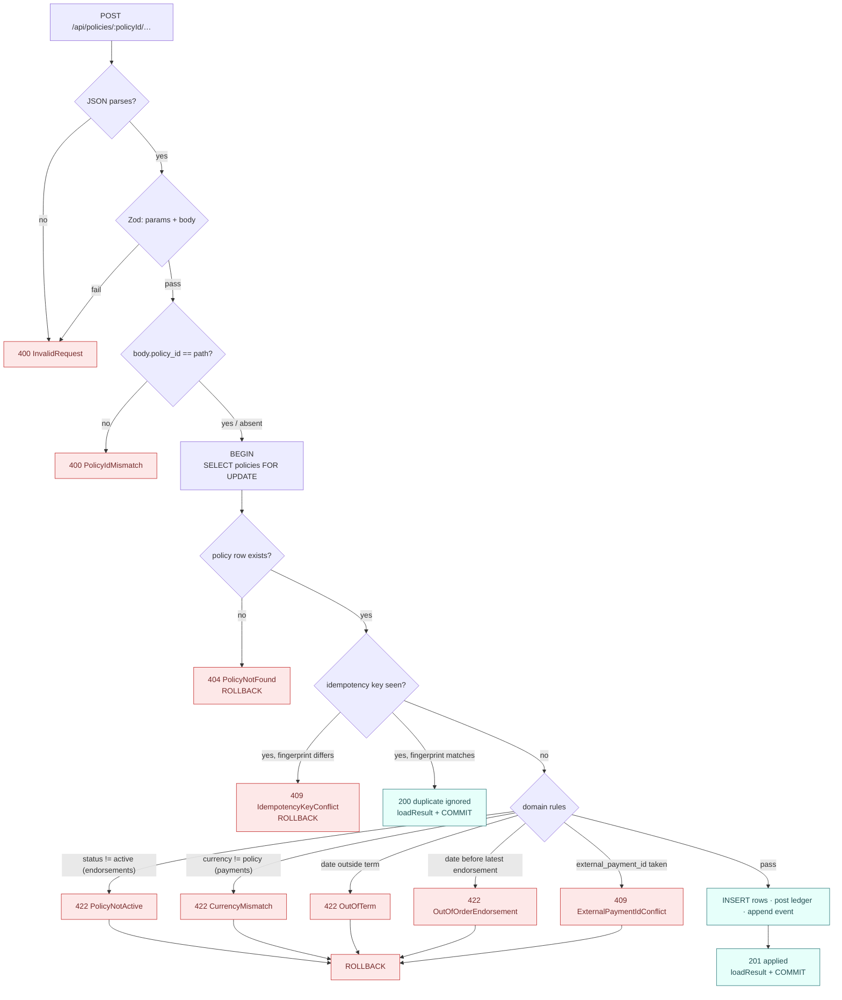

# 0006: The 400/422 rule, and two identifiers for a payment

## Status

Accepted. Source: [#10](https://github.com/angelguzmaning/policy-ledger-service/issues/10) (API contract
and error model for all six endpoints).

## Context

Ten distinct error codes needed one governing rule, or the split between "this is a `400`" and "this is a
`422`" would drift case by case as new endpoints were added. Separately, a payment carries two candidate
identifiers — the idempotency key and the upstream system's own payment id — and the schema (ADR-0003,
`docs/spec/schema-and-transactions.md`) needed to decide whether both are enforced.

## Decision

### One rule governs the whole error model

> **Decidable from the request alone → `400`. Requires policy state → `422`.**

`currency` is Zod-validated for *shape only* (`/^[A-Z]{3}$/`), never `z.literal('USD')` — pinning it would
turn `PAY-9002` into a `400 InvalidRequest` and delete the brief's own named `currency mismatch` failure
path, which can only exist if a non-`USD` currency is a **valid-shaped** request that the *service* then
rejects against policy state. The rule also relocated the ticket's own first draft: a body `policy_id` that
disagrees with the path is decidable without touching the database, so `PolicyIdMismatch` is **`400`, not
`422`** — a rule bent on its own first application is not a rule.

Guard order follows directly: `400` guards (JSON parse, Zod, `PolicyIdMismatch`) run before `BEGIN`;
`404 PolicyNotFound` and the idempotency lookup run under the lock; `422`s run last, after the target's
identity and delivery history are both settled.

`PolicyNotActive` gates **endorsements only**, and sits **after** the idempotency lookup — a replay of an
endorsement legitimately applied while the policy was active must keep replaying after cancellation; the
original result does not expire. Payments have no `PolicyNotActive` guard at all: the brief states a
payment already happened in another system, so the cash is a fact, and refusing a genuine receipt against a
lapsed policy would destroy that fact rather than protect anything.

### Two identifiers for a payment, both `UNIQUE`

`idempotency_key` and `external_payment_id` are **two identifiers, not one**, and both carry a `UNIQUE`
constraint. The idempotency key is delivery-retry identity — it is the row's primary key, per ADR-0003.
`external_payment_id` is the upstream system's own identity for the payment. They coincide in the sample
data (`PAY-9001` is both), but they answer different questions, and the second constraint catches a bug the
first cannot: **the same real-world payment redelivered under a fresh idempotency key** would otherwise
debit cash a second time with nothing to notice, because a fresh key means a fresh row as far as ADR-0003's
mechanism is concerned. A new error code, `409 ExternalPaymentIdConflict`, fires when `external_payment_id`
is already recorded under a different `payment_id`.

## Rejected alternatives

- **A single flat error-code list with status assigned case by case**, no governing rule. Rejected because
  it produces exactly the drift this decision exists to prevent — the next endpoint's author has nothing to
  check a new code's status against except "what did the others do," and the `PolicyIdMismatch` relocation
  during this ticket is direct evidence that reasoning by precedent alone gets it wrong on the first try.
- **`currency: z.literal('USD')`** at the validation layer. Rejected: it would make `PAY-9002` a `400`
  instead of a `422`, deleting the brief's named currency-mismatch failure path entirely — the request
  would never reach the service layer that's supposed to reject it.
- **One identifier only — treat `external_payment_id` as redundant with `idempotency_key`.** Rejected
  because it is the specific case the second constraint exists to catch: an upstream redelivering the same
  real payment under a fresh key is indistinguishable from a genuinely new payment if only the key is
  checked, and the cash gets posted twice.
- **Rejecting a duplicate `external_payment_id` with the same `422`-style "requires policy state" status**
  instead of a distinct `409`. Rejected for consistency with `IdempotencyKeyConflict`: both are conflicts
  over *identity*, not over policy business rules, and `409` is the status HTTP reserves for exactly that
  class of conflict.

## Known limitations

**The 400/422 rule is a two-way split; some real systems distinguish more finely** (e.g. `400` for
syntactic errors vs. a separate `422` reserved only for semantic-but-structurally-valid bodies, with policy
state failures as their own class). _How you would notice:_ a future endpoint whose validation needs a
third bucket the rule doesn't name. _What you would do:_ the rule is stated as one sentence specifically so
it is easy to re-derive a new code's status from it; if a genuine third case arrives, extend the rule
explicitly rather than pattern-matching off existing codes.

**`external_payment_id` uniqueness is global, not scoped per policy.** If two different insurers' policies
somehow shared an upstream payment processor that reused ids across customers, a collision would be rejected
as `409 ExternalPaymentIdConflict` rather than accepted as two independent payments. _How you would notice:_
a `409` on a payment the caller believes is genuinely unrelated to any prior one. _What you would do:_ this
mirrors ADR-0003's identical limitation on idempotency-key scope, and the fix is the same shape — scope the
constraint to `(policy_id, external_payment_id)` if cross-policy collision becomes a real scenario rather
than a hypothetical one.

**No exponential backoff or rate limiting on `409` responses.** A caller that retries an `IdempotencyKeyConflict`
or `ExternalPaymentIdConflict` in a tight loop is not throttled by this API. _How you would notice:_ a
misbehaving integration hammering the same conflicting request. _What you would do:_ out of scope here —
covered by the same "no rate limiting" limitation already logged against the API contract doc in
`docs/known-limitations.md`.
