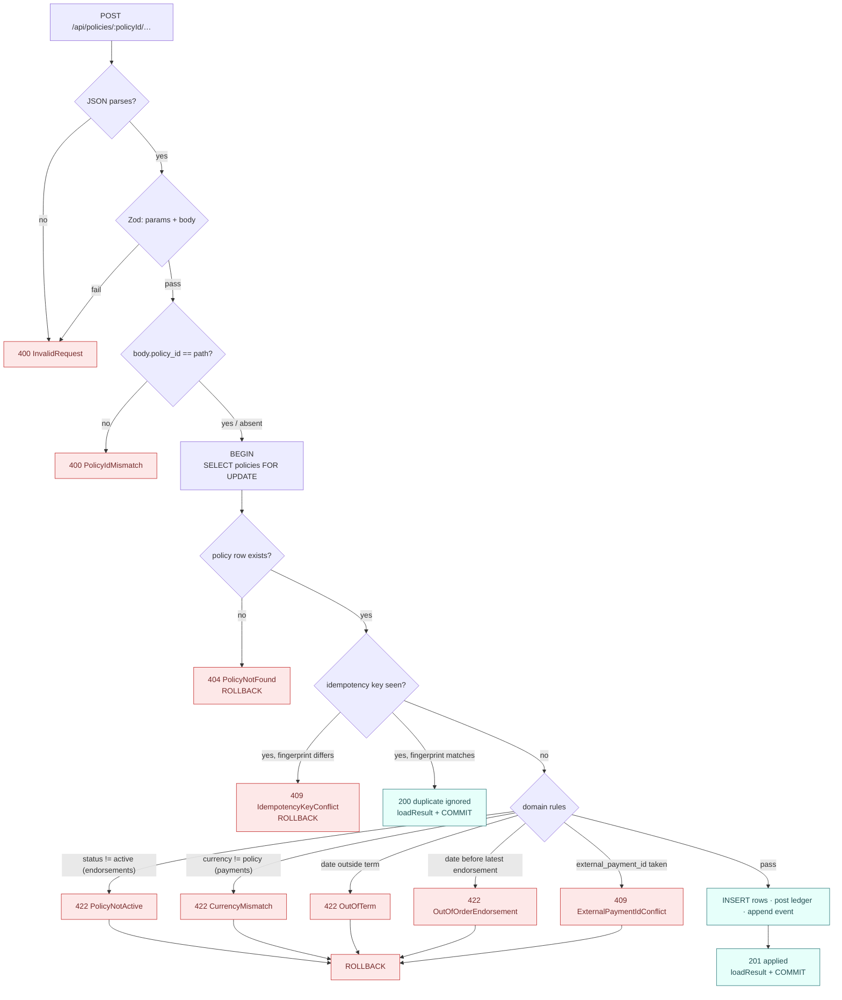

# API contract and error model

Resolves [#10](https://github.com/angelguzmaning/policy-ledger-service/issues/10). Inherits the decisions made in
[#5](https://github.com/angelguzmaning/policy-ledger-service/issues/5) (proration and money),
[#6](https://github.com/angelguzmaning/policy-ledger-service/issues/6) (ledger model),
[#7](https://github.com/angelguzmaning/policy-ledger-service/issues/7) (idempotency) and
[#8](https://github.com/angelguzmaning/policy-ledger-service/issues/8) (hash chain).

All six endpoints are Next.js route handlers under `src/app/api/policies/[policyId]/`. Every response is
`Content-Type: application/json; charset=utf-8`. Every `GET` sends `Cache-Control: no-store` — this is live
financial state and must never be served from a cache.

---

## 1. Where validation lives

The route handler owns HTTP; the service layer owns the domain and never imports a Next type.

```
route handler                     service layer                    one mapper
─────────────                     ─────────────                    ──────────
Zod: params + body        ──▶     typed command object      ──▶    toHttpResponse(error)
throws InvalidRequest             throws PolicyNotFound,           domain error ─▶ status
                                  CurrencyMismatch, …              + error envelope
```

A handler is three statements: parse, call the service, map the outcome. The service throws typed domain errors
that carry the data the message needs and know nothing about status codes. `toHttpResponse` is the single place a
domain error becomes an HTTP status, so the mapping is a table one can read rather than a rule scattered across
six files.

### The 400 / 422 rule

> **Decidable from the request alone → `400`. Requires policy state → `422`.**

This is the whole rule, and it is what makes the split defensible rather than a matter of taste. `currency` is
therefore validated by Zod for _shape only_ (`/^[A-Z]{3}$/`) and never pinned to `USD`: pinning it would turn
`PAY-9002` into a `400 InvalidRequest` and the brief's named `currency mismatch` failure path would cease to exist.

The rule also relocates one code from its first draft. A body `policy_id` that disagrees with the path is decidable
without a database read, so **`PolicyIdMismatch` is `400`, not `422`**.

---

## 2. Request bodies accept the brief's event objects verbatim

`events.json` objects are `POST`-able unchanged. A reviewer can `curl` any sample event straight at the endpoint
during the walkthrough and it works — which is worth more than schema purity, because the alternative is a `400` in
front of an audience.

`type` and `policy_id` are accepted as optional keys, validated, and then **stripped** before the command reaches
the service.

```ts
const PolicyParams = z.strictObject({
  policyId: z.string().regex(/^[A-Za-z0-9_-]{1,64}$/),
})

const EndorsementBody = z.strictObject({
  type: z.literal('endorsement.requested').optional(), // accepted, ignored
  policy_id: z.string().optional(), // accepted, must match the path
  idempotency_key: z.string().regex(/^[A-Za-z0-9_-]{1,64}$/),
  effective_date: z.string().regex(/^\d{4}-\d{2}-\d{2}$/),
  new_annual_premium_cents: z.int().positive(),
  reason: z.string().min(1).max(500).optional(),
})

const PaymentBody = z.strictObject({
  type: z.literal('payment.received').optional(),
  policy_id: z.string().optional(),
  idempotency_key: z.string().regex(/^[A-Za-z0-9_-]{1,64}$/),
  external_payment_id: z.string().regex(/^[A-Za-z0-9_-]{1,64}$/),
  amount_cents: z.int().positive(),
  currency: z.string().regex(/^[A-Z]{3}$/), // shape only — never z.literal('USD')
  received_at: z.string().regex(/^\d{4}-\d{2}-\d{2}T\d{2}:\d{2}:\d{2}Z$/),
})
```

### The strip is load-bearing

```ts
function parseEndorsement(policyId: string, raw: unknown): EndorsementCommand {
  const parsed = EndorsementBody.safeParse(raw)
  if (!parsed.success) throw new InvalidRequest(parsed.error)
  if (parsed.data.policy_id !== undefined && parsed.data.policy_id !== policyId) {
    throw new PolicyIdMismatch(policyId, parsed.data.policy_id)
  }
  const { type: _type, policy_id: _policyId, ...command } = parsed.data
  return command // the body half of the fingerprint preimage
}
```

`#7` fingerprints the **validated** request. If `type` and `policy_id` survived into that object, a retry that
omitted them would hash differently and return `409 IdempotencyKeyConflict` on a semantically identical payload —
idempotency broken by a decorative field. Stripping them is not tidiness; it is the correctness of the retry path.

The preimage is therefore:

```ts
fingerprint = sha256(canonicalJson({ policy_id: policyId /* from the path */, ...command }))
```

`received_at` is regex-pinned to exactly one rendering (`2026-07-03T18:30:00Z`, no milliseconds) per `#8`: the value
is hash-covered, so `…:00Z` and `…:00.000Z` would otherwise produce different chains for the same instant.

`reason` is inside the command, so it is inside the fingerprint. A retry that changes the reason is a different
payload and correctly conflicts.

---

## 3. Error envelope

One shape for every failure. Success and error bodies are structurally disjoint — a client tests `'error' in body`
and needs nothing else.

```jsonc
{
  "error": {
    "code": "CurrencyMismatch",
    "message": "Policy POL-1001 is denominated in USD; payment PAY-9002 is in EUR.",
  },
}
```

`details` is present **only** for `InvalidRequest`, built from Zod's `issues`, and is omitted entirely rather than
sent as `[]` — which suits the repo's `exactOptionalPropertyTypes`.

```jsonc
{
  "error": {
    "code": "InvalidRequest",
    "message": "Request body failed validation.",
    "details": [
      { "path": "amount_cents", "message": "Expected integer, received number" },
      { "path": "received_at", "message": "Invalid input: must match /^\\d{4}-…Z$/" },
    ],
  },
}
```

```ts
const details = error.issues.map((i) => ({
  path: i.path.join('.'),
  message: i.message,
}))
```

### Code table

| Code                        | Status | Raised when                                                           | Decided by |
| --------------------------- | ------ | --------------------------------------------------------------------- | ---------- |
| `InvalidRequest`            | `400`  | Zod failure on params or body; unknown key; malformed JSON            | #7, here   |
| `PolicyIdMismatch`          | `400`  | body `policy_id` present and ≠ path `policyId`                        | here       |
| `PolicyNotFound`            | `404`  | no `policies` row for the path id                                     | #7         |
| `IdempotencyKeyConflict`    | `409`  | key exists, stored fingerprint differs                                | #7         |
| `ExternalPaymentIdConflict` | `409`  | `external_payment_id` already recorded under a different `payment_id` | here       |
| `PolicyNotActive`           | `422`  | endorsement against a policy whose status ≠ `active`                  | here       |
| `OutOfTerm`                 | `422`  | `effective_date` outside `[term_start, term_end]` inclusive           | #5         |
| `OutOfOrderEndorsement`     | `422`  | `effective_date` earlier than the latest applied endorsement's        | #5         |
| `CurrencyMismatch`          | `422`  | `body.currency` ≠ `policies.currency`                                 | #6, here   |
| `InternalError`             | `500`  | anything unhandled                                                    | here       |

`InternalError` never leaks a Postgres message. It returns a generated `request_id`, logs the cause against that id,
and says nothing else — the on-call note points at the correlation, not the response.

```jsonc
{
  "error": {
    "code": "InternalError",
    "message": "An unexpected error occurred.",
    "request_id": "01JQ8…",
  },
}
```

### Guard order

`#7` fixed the order; two guards join it. Note that `PolicyNotActive` sits **after** the idempotency lookup: a
replay of an endorsement that was legitimately applied while the policy was active must keep replaying after the
policy is cancelled. The original result does not expire.



Every terminal error rolls back, so **a rejected request never consumes its key** (`#7`): `PAY-9002` in EUR fails and
the same id resubmitted in USD succeeds. The `inbound_requests` receipt (`#8`) is written on a separate connection
and survives the rollback.

---

## 4. `POST /api/policies/:policyId/endorsements`

### Request

```json
{
  "type": "endorsement.requested",
  "idempotency_key": "END-2001",
  "policy_id": "POL-1001",
  "effective_date": "2026-07-01",
  "new_annual_premium_cents": 144000,
  "reason": "Water-shutoff discount removed"
}
```

### `201 Created`

The response carries the effects of **this request only** — not the whole policy. The UI then invalidates and
refetches the policy view, which is precisely the refetch-after-mutation flow `#16` identified as TanStack Query's
reason to be in this build. Returning the full policy and seeding the cache would delete the thing the frontend
exists to demonstrate.

When the delta is positive, `billing_document.status` reflects the **post-sweep** state, not the state the
document was written in: any payment remainders already on the policy settle against it, in the same
transaction, before the response is built (ADR-0007). A charge fully covered by an existing remainder comes
back `paid` in the very response that created it, not `open`.

```json
{
  "endorsement_id": "END-2001",
  "policy_id": "POL-1001",
  "effective_date": "2026-07-01",
  "previous_annual_premium_cents": 120000,
  "new_annual_premium_cents": 144000,
  "delta_cents": 12099,
  "billing_document": {
    "id": "BILL-3001",
    "type": "premium_charge",
    "amount_cents": 12099,
    "status": "open"
  },
  "ledger_transaction_ids": ["0198f2c1-4a3e-7c11-9f0b-2a1d8e6b4c33"],
  "open_balance_cents": 12099,
  "policy_event": {
    "seq": 2,
    "event_type": "endorsement_applied",
    "event_hash": "4e80a1…"
  },
  "idempotency_result": "applied"
}
```

### `200 OK` — replay

Byte-identical to the original except `"idempotency_result": "duplicate ignored"`. This is guaranteed by
construction, not by agreement: both paths call the same `loadEndorsementResult(tx, id)` projection inside the
transaction (`#7`).

### Zero delta

`#5` decided a zero delta writes a policy event but **no** billing document and **no** ledger transaction. The keys
stay present so the response shape is stable:

```json
{
  "endorsement_id": "END-2004",
  "delta_cents": 0,
  "billing_document": null,
  "ledger_transaction_ids": [],
  "open_balance_cents": 12099,
  "policy_event": { "seq": 4, "event_type": "endorsement_applied", "event_hash": "b91c…" },
  "idempotency_result": "applied"
}
```

### Failures

`400 InvalidRequest` · `400 PolicyIdMismatch` · `404 PolicyNotFound` · `409 IdempotencyKeyConflict` ·
`422 PolicyNotActive` · `422 OutOfTerm` · `422 OutOfOrderEndorsement` · `500 InternalError`

```jsonc
// 422 — effective_date 2025-12-31 against a term starting 2026-01-01
{
  "error": {
    "code": "OutOfTerm",
    "message": "effective_date 2025-12-31 is outside the policy term 2026-01-01 to 2027-01-01.",
  },
}
```

---

## 5. `POST /api/policies/:policyId/payments`

### Request

```json
{
  "type": "payment.received",
  "idempotency_key": "PAY-9001",
  "policy_id": "POL-1001",
  "external_payment_id": "PAY-9001",
  "amount_cents": 12099,
  "currency": "USD",
  "received_at": "2026-07-03T18:30:00Z"
}
```

`idempotency_key` and `external_payment_id` are **two identifiers**, not one. The key is delivery-retry identity and
is the row's primary key; `external_payment_id` is the upstream system's identity for the payment and carries its
own `UNIQUE`. They coincide in the sample data, but they are different facts, and the second constraint catches a
bug the first cannot: the same real-world payment redelivered under a fresh key would otherwise debit cash twice
with nothing noticing.

### `201 Created`

```json
{
  "payment_id": "PAY-9001",
  "external_payment_id": "PAY-9001",
  "policy_id": "POL-1001",
  "amount_cents": 12099,
  "currency": "USD",
  "received_at": "2026-07-03T18:30:00Z",
  "status": "applied",
  "applications": [
    {
      "billing_document_id": "BILL-3001",
      "amount_cents": 12099,
      "document_status_after": "paid"
    }
  ],
  "unapplied_cents": 0,
  "ledger_transaction_ids": ["0198f2c1-9b7d-7a04-8e52-6f3c0d1a5b88"],
  "open_balance_cents": 0,
  "policy_event": {
    "seq": 3,
    "event_type": "payment_recorded",
    "event_hash": "7c31b2…"
  },
  "idempotency_result": "applied"
}
```

`applications` is `#6`'s oldest-open-first waterfall made visible — the response shows which documents the money
settled and in what order, so the allocation rule is demonstrable rather than asserted.

### Payment `status` is derived

A rejected payment is never persisted, so a stored `status` of `"applied"` would be a constant and therefore
meaningless. It earns its place by describing **allocation**, consistent with `#6`'s derived document status:

| Condition                          | `status`            |
| ---------------------------------- | ------------------- |
| `applied == amount_cents`          | `applied`           |
| `0 < applied < amount_cents`       | `partially_applied` |
| `applied == 0` (no open documents) | `unapplied`         |

An `unapplied` payment is not an error: the cash is posted, `premium_receivable` goes to a credit balance, and
`open_balance_cents` goes negative — `#5`'s no-refund position.

### Failures

`400 InvalidRequest` · `400 PolicyIdMismatch` · `404 PolicyNotFound` · `409 IdempotencyKeyConflict` ·
`409 ExternalPaymentIdConflict` · `422 CurrencyMismatch` · `500 InternalError`

Note there is **no** `PolicyNotActive` here. The brief states the payment already occurred in another system, so the
cash is a fact; refusing to record a genuine receipt against a lapsed policy destroys the receipt and unbalances
cash against reality. A final payment on a cancelled policy is a normal insurance event. The brief agrees literally —
"validate status" appears on the endorsement endpoint and nowhere else.

```jsonc
// 422 — the brief's PAY-9002
{
  "error": {
    "code": "CurrencyMismatch",
    "message": "Policy POL-1001 is denominated in USD; payment PAY-9002 is in EUR.",
  },
}
```

---

## 6. `GET /api/policies/:policyId`

A **strict superset** of the brief's Expected Output example: every key name and nesting level is preserved, and
every difference is an addition. The reviewer can diff our response against their example line by line.

```json
{
  "policy_id": "POL-1001",
  "homeowner_id": "HOME-204",
  "status": "active",
  "currency": "USD",
  "term_start": "2026-01-01",
  "term_end": "2027-01-01",
  "annual_premium_cents": 144000,
  "endorsements": [
    {
      "id": "END-2001",
      "effective_date": "2026-07-01",
      "delta_cents": 12099,
      "billing_document": {
        "id": "BILL-3001",
        "type": "premium_charge",
        "amount_cents": 12099,
        "status": "paid"
      },
      "idempotency_result": "duplicate ignored"
    }
  ],
  "payments": [
    {
      "external_payment_id": "PAY-9001",
      "amount_cents": 12099,
      "status": "applied",
      "idempotency_result": "duplicate ignored",
      "received_at": "2026-07-03T18:30:00Z"
    }
  ],
  "open_balance_cents": 0,
  "ledger": {
    "balanced": true,
    "transactions": [
      { "source": "END-2001", "debits_cents": 12099, "credits_cents": 12099 },
      { "source": "PAY-9001", "debits_cents": 12099, "credits_cents": 12099 }
    ]
  },
  "history": {
    "valid": true,
    "event_count": 3,
    "events": ["policy_created", "endorsement_applied", "payment_recorded"]
  },
  "rejected_events": [{ "id": "PAY-9002", "reason": "currency mismatch" }],
  "explanation": "Policy POL-1001 is active with an annual premium of $1,440.00 USD for the term 2026-01-01 to 2027-01-01. 1 endorsement has been applied, most recently END-2001 effective 2026-07-01, which raised the annual premium by $240.00 and billed $120.99 pro-rata. The account is fully paid; there is no outstanding balance. The policy history chain of 3 events verifies intact. 1 inbound request was rejected: PAY-9002 (currency mismatch).",
  "explanation_clauses": [
    "Policy POL-1001 is active with an annual premium of $1,440.00 USD for the term 2026-01-01 to 2027-01-01.",
    "1 endorsement has been applied, most recently END-2001 effective 2026-07-01, which raised the annual premium by $240.00 and billed $120.99 pro-rata.",
    "The account is fully paid; there is no outstanding balance.",
    "The policy history chain of 3 events verifies intact.",
    "1 inbound request was rejected: PAY-9002 (currency mismatch)."
  ],
  "suggested_action": "No action required"
}
```

### Additions, and the four deviations

| Field                                          | Why                                                                                                                     |
| ---------------------------------------------- | ----------------------------------------------------------------------------------------------------------------------- |
| `homeowner_id`, `currency`, `term_start/end`   | the brief's Frontend Requirement names all of them in the policy view                                                   |
| `endorsements[].effective_date`, `delta_cents` | the proration result is otherwise invisible without a second call                                                       |
| `payments[].received_at`                       | the date the timeline sorts payments by (see below); previously validated and echoed on write but never exposed on read |
| `history.events`                               | makes the `event_count` deviation explain itself on sight                                                               |
| `explanation`                                  | Required Output Field; see §8                                                                                           |
| `explanation_clauses`                          | the same clauses of §9 unjoined, so the UI paragraphs them instead of re-splitting prose                                |

| Deviation                                                 | Reason                                                                                                                                                                                                                  |
| --------------------------------------------------------- | ----------------------------------------------------------------------------------------------------------------------------------------------------------------------------------------------------------------------- |
| `type` is `premium_charge` / `premium_credit`             | `#5` — direction carried by type with `CHECK (amount_cents > 0)` intact; the brief's `endorsement_adjustment` cannot express a credit                                                                                   |
| `event_count` is 3, not 2                                 | `#8` — `policy_created` is in the chain so the premium baseline is hash-covered; the adjacent `events` list makes the difference self-evident                                                                           |
| `ledger.balanced` exists here but not on `/ledger`        | Required Output Fields asks for "balanced status"; `#6` refused a bare boolean on the ledger endpoint. Split by role: **the summary asserts, the ledger proves**                                                        |
| `billing_document.status` can be `issued`, a fourth value | `#19`/[ADR-0007](../adr/0007-continuous-allocation-and-credit-exclusion.md) — a `premium_credit` is never payable and reporting it `open` reads as "awaiting payment," backwards for money the insurer owes the insured |

`ledger.balanced` is computed, never stored:
`sum_all_entries === 0 && unbalanced_transactions.length === 0`.

`idempotency_result` on a `GET` comes from the `inbound_requests` log (`#8`) — it reports the last delivery outcome
for that id, which is what makes the brief's example reproducible literally instead of requiring the interpretive
bet that the example was really a replay report.

`payments[]` is ordered by `received_at` (earliest first), tiebroken on `payment_id` — **display order**, not the
oldest-open-first **allocation order** ADR-0004 uses to route cash against open documents. The two are deliberately
different (ADR-0004 §"Allocation order vs. display order"): a back-dated payment settles whatever is open when it
lands, it does not reach back and re-cut allocations already made.

### Failures

`400 InvalidRequest` (path segment cannot be an identifier) · `404 PolicyNotFound` · `500 InternalError`

---

## 7. `GET /api/policies/:policyId/ledger`

`#6`'s payload, ratified unchanged. The endpoint **proves** balance rather than asserting it — no boolean here; the
numbers are the evidence.

```json
{
  "policy_id": "POL-1001",
  "currency": "USD",
  "transactions": [
    {
      "id": "0198f2c1-4a3e-7c11-9f0b-2a1d8e6b4c33",
      "source_type": "endorsement",
      "source_id": "END-2001",
      "description": "Premium delta for endorsement END-2001",
      "posted_at": "2026-07-01T00:00:00.000Z",
      "entries": [
        { "account": "premium_receivable", "amount_cents": 12099, "direction": "debit" },
        { "account": "written_premium", "amount_cents": -12099, "direction": "credit" }
      ]
    },
    {
      "id": "0198f2c1-9b7d-7a04-8e52-6f3c0d1a5b88",
      "source_type": "payment",
      "source_id": "PAY-9001",
      "description": "Payment PAY-9001 received",
      "posted_at": "2026-07-03T18:30:00.000Z",
      "entries": [
        { "account": "cash", "amount_cents": 12099, "direction": "debit" },
        { "account": "premium_receivable", "amount_cents": -12099, "direction": "credit" }
      ]
    }
  ],
  "account_balances": {
    "cash": 12099,
    "premium_receivable": 0,
    "written_premium": -12099
  },
  "sum_all_entries": 0,
  "unbalanced_transactions": []
}
```

`unbalanced_transactions` is `GROUP BY transaction_id HAVING SUM(amount_cents) <> 0`. The deferred constraint trigger
makes it structurally always empty — **that is the point**. It is a live invariant probe, and the on-call note points
at it as the first query to run at 3am.

`direction` is derived for display by one formatter (`amount_cents > 0 ? 'debit' : 'credit'`); there is no `CASE`
expression anywhere in schema, service or API.

### Failures

`400 InvalidRequest` · `404 PolicyNotFound` · `500 InternalError`

---

## 8. `GET /api/policies/:policyId/history/verify`

`#8`'s payload, ratified unchanged. **`200` whenever verification ran** — "the history is broken" is a correct
answer, not a server failure. `404` only for an unknown policy.

```json
{
  "valid": true,
  "event_count": 3,
  "events": ["policy_created", "endorsement_applied", "payment_recorded"],
  "head_hash": "4e80a1c9…"
}
```

```json
{
  "valid": false,
  "event_count": 3,
  "verified_through_seq": 1,
  "break": {
    "seq": 2,
    "reason": "event_hash_mismatch",
    "expected_event_hash": "9c22f0…",
    "stored_event_hash": "1b7fa4…"
  }
}
```

| `reason`                 | Tampering shape             |
| ------------------------ | --------------------------- |
| `event_hash_mismatch`    | row content edited          |
| `previous_hash_mismatch` | link broken or substituted  |
| `sequence_gap`           | row deleted from the middle |
| `missing_genesis`        | no `seq` 1                  |

Only the **first** break is reported: everything after the earliest divergence is suspect by association, and the
earliest divergence is what gets acted on. `verified_through_seq` tells the operator how much history is still
provably intact — the difference between an alarm and a diagnosis.

### Failures

`400 InvalidRequest` · `404 PolicyNotFound` · `500 InternalError`

---

## 9. The readable summary — rule-based, no LLM

`explanation` and `suggested_action` are a **pure function of policy state**. No model call, no API key, no secrets
story, no non-determinism in the test suite, and no path by which a hallucinated number reaches an operator reading
a financial summary. Every sentence is table-testable with zero mocks.

This is not a rejection of the client's AI thesis. The README states explicitly where an LLM _does_ belong in this
system — drafting the insured-facing dunning message, triaging the rejected-request queue — and why it deliberately
does not sit between the ledger and the operator.

### Money formatting

Display formatting uses `BigInt`, not float division, so the "no floating point in financial logic" rule needs no
carve-out for the presentation layer:

```ts
function formatMoney(cents: number, currency: string): string {
  const negative = cents < 0
  const abs = BigInt(negative ? -cents : cents)
  const major = (abs / 100n).toLocaleString('en-US')
  const minor = String(abs % 100n).padStart(2, '0')
  return `${negative ? '-' : ''}$${major}.${minor} ${currency}`
}
```

### `explanation` — clauses in fixed order

| #   | Clause      | Condition         | Template                                                                                                                                                             |
| --- | ----------- | ----------------- | -------------------------------------------------------------------------------------------------------------------------------------------------------------------- |
| 1   | Policy      | always            | `Policy {id} is {status} with an annual premium of {premium} for the term {term_start} to {term_end}.`                                                               |
| 2   | Endorsement | ≥ 1 applied       | `{n} endorsement(s) have been applied, most recently {id} effective {date}, which {raised\|lowered} the annual premium by {abs_delta} and billed {amount} pro-rata.` |
| 2   | Endorsement | zero-delta latest | `… most recently {id} effective {date}, which left the annual premium unchanged and produced no billing document.`                                                   |
| 2   | Endorsement | none applied      | _(clause omitted)_                                                                                                                                                   |
| 3   | Balance     | `> 0`             | `{amount} is currently outstanding across {n} open billing document(s).`                                                                                             |
| 3   | Balance     | `== 0`            | `The account is fully paid; there is no outstanding balance.`                                                                                                        |
| 3   | Balance     | `< 0`             | `The account holds a credit of {amount}, which will offset future charges. No refund is issued by this system.`                                                      |
| 4   | History     | valid             | `The policy history chain of {n} events verifies intact.`                                                                                                            |
| 4   | History     | broken            | `History verification FAILED at event {seq} ({reason}); events 1 to {verified_through_seq} remain provably intact.`                                                  |
| 5   | Rejected    | ≥ 1 rejection     | `{n} inbound request(s) were rejected: {id} ({reason})[, …].`                                                                                                        |
| 5   | Rejected    | none              | _(clause omitted)_                                                                                                                                                   |

### `suggested_action` — first match wins

The ladder answers **"what must the operator do about this policy?"**, so it reads policy state only.

| #   | Condition          | Action                                                                                                                                  |
| --- | ------------------ | --------------------------------------------------------------------------------------------------------------------------------------- |
| 1   | history invalid    | `Investigate history integrity: verification failed at event {seq} ({reason}). Do not rely on derived balances until this is resolved.` |
| 2   | `balance > 0`      | `Collect the outstanding balance of {amount}.`                                                                                          |
| 3   | `balance < 0`      | `Review the credit balance of {amount} with the insured; no refund is issued by this system.`                                           |
| 4   | `status != active` | `Policy is {status}; no further endorsements can be applied.`                                                                           |
| 5   | otherwise          | `No action required`                                                                                                                    |

**Rejections deliberately do not appear in this ladder.** A currency-mismatch rejection is evidence the system
worked: we refused the record, so the policy stayed correct. Nothing about `POL-1001` is wrong and nothing is missing
from its ledger — the bad data is the upstream's hygiene problem, not a defect in the policy. Rejections are
therefore _reported_ (in `rejected_events` and in explanation clause 5) and never _actioned_.

This is why the brief's sample state yields `"No action required"` — for a stated reason, not by coincidence.

---

## 10. HTTP details

| Concern        | Decision                                                                                                          |
| -------------- | ----------------------------------------------------------------------------------------------------------------- |
| Content type   | `application/json; charset=utf-8` on every response, success and error alike                                      |
| `GET` caching  | `Cache-Control: no-store` — live financial state                                                                  |
| Malformed JSON | `req.json()` throws → `400 InvalidRequest`, message `"Request body is not valid JSON."`                           |
| Unknown method | Next returns `405` for an unexported handler; not our concern                                                     |
| Unknown policy | `404 PolicyNotFound` for anything not in the table, including `PQL-1001` and `hello`                              |
| Malformed path | `400 InvalidRequest` only when the segment cannot be an identifier at all (empty, > 64 chars, illegal characters) |
| Trailing state | every `4xx`/`5xx` on a write path is preceded by `ROLLBACK`; the key is never consumed                            |

The path rule is deliberately **not** `/^POL-\d+$/`. `#7` argued that a service should not dictate its callers' id
schemes, and pinning the prefix here would produce the operator-confusing split where a typo'd `PQL-1001` returns
`400` while a genuine miss `POL-9999` returns `404`. A bounded opaque string gives one rule: _if it could be an id
and we don't have it, it's a 404._

---

## 11. Test table

| #   | Case                                                                | Expected                                                                            |
| --- | ------------------------------------------------------------------- | ----------------------------------------------------------------------------------- |
| 1   | `events.json` endorsement object POSTed verbatim                    | `201 applied` — `type` and `policy_id` accepted and ignored                         |
| 2   | Same object with `type` omitted                                     | `200 duplicate ignored` — the strip keeps the fingerprint stable                    |
| 3   | Body `policy_id: "POL-9999"` against path `POL-1001`                | `400 PolicyIdMismatch`, no writes                                                   |
| 4   | Unknown body key `{ …, foo: 1 }`                                    | `400 InvalidRequest`, `details[0].path === "foo"`                                   |
| 5   | `amount_cents: 120.5`                                               | `400 InvalidRequest`, `details[0].path === "amount_cents"`                          |
| 6   | `received_at: "2026-07-03T18:30:00.000Z"`                           | `400 InvalidRequest` — one legal rendering only                                     |
| 7   | Malformed JSON body                                                 | `400 InvalidRequest`, `"Request body is not valid JSON."`                           |
| 8   | `GET /api/policies/hello`                                           | `404 PolicyNotFound`                                                                |
| 9   | `GET /api/policies/<65 chars>`                                      | `400 InvalidRequest`                                                                |
| 10  | `PAY-9002` in EUR                                                   | `422 CurrencyMismatch`, `ROLLBACK`, one `inbound_requests` row                      |
| 11  | `PAY-9002` resubmitted in USD                                       | `201 applied` — the key was never consumed                                          |
| 12  | `PAY-9001` amount redelivered as key `PAY-9003`                     | `409 ExternalPaymentIdConflict`, cash debited once                                  |
| 13  | Endorsement against a `cancelled` policy                            | `422 PolicyNotActive`                                                               |
| 14  | Payment against a `cancelled` policy                                | `201 applied` — receipts are always recordable                                      |
| 15  | Replay of an endorsement applied while active, policy now cancelled | `200 duplicate ignored` — the original result does not expire                       |
| 16  | Zero-delta endorsement                                              | `201`, `billing_document: null`, `ledger_transaction_ids: []`, event written        |
| 17  | Overpayment of 20000 against a 12099 document                       | `status: "partially_applied"`… `unapplied_cents: 7901`, `open_balance_cents: -7901` |
| 18  | Payment with no open documents                                      | `status: "unapplied"`, negative open balance, cash still posted                     |
| 19  | Full brief sample state → `GET /api/policies/POL-1001`              | matches the Expected Output example modulo the three documented deviations          |
| 20  | `suggested_action` with a rejection present and balance 0           | `"No action required"`                                                              |
| 21  | `suggested_action` with a broken chain and balance 0                | history clause wins the ladder                                                      |
| 22  | Every error response                                                | has `error.code`; `details` present iff `code === "InvalidRequest"`                 |
| 23  | `500` response                                                      | carries `request_id`, leaks no Postgres text                                        |

Case 15 is the subtle one: it is why `PolicyNotActive` sits after the idempotency lookup rather than before it.

---

## Known limitations

**Rejections are reported but never actioned.** `suggested_action` reads policy state only, so an upstream that
sends malformed records indefinitely produces a stream of `rejected_events` and a permanent "No action required".
_How you would notice:_ the `inbound_requests` rollup query in the on-call note
(`SELECT outcome, error_code, count(*) … GROUP BY 1,2`) shows the rejection rate directly. _What you would do:_ alert
on rejection rate at the integration layer, where upstream health belongs, rather than inflating a per-policy field
into a queue monitor.

**`GET /api/policies/:policyId` and `/ledger` have no pagination.** Both return the policy's full history. At
take-home scale this is a handful of rows; a policy with years of monthly billing would return an unbounded payload.
_How you would notice:_ p99 latency on those two routes climbing with policy age. _What you would do:_ cursor
pagination on `transactions` and a bounded `endorsements`/`payments` window, with the summary fields computed by
aggregate rather than by counting the returned array.

**`ledger.balanced` on the policy view is a computed claim, not a proof.** It is derived from the same two probes
`/ledger` exposes, so it cannot disagree with them — but a client that reads only the boolean has taken our word for
it. _How you would notice:_ it would not differ; the risk is a consumer building on the boolean and never learning
the probes exist. _What you would do:_ nothing at this scale; the field exists because the brief's Required Output
Fields names it, and `/ledger` remains the evidence.

**The explanation templates are English-only and not localized.** Sentence assembly is string concatenation in a
fixed clause order, which does not survive translation. _How you would notice:_ the first non-English market.
_What you would do:_ return the structured facts (`SummaryFacts`) alongside the rendered string and move rendering
to the client, where locale lives.

**No request-level rate limiting or payload size cap beyond Next's default.** A single oversized body reaches Zod
before it is rejected. _How you would notice:_ memory pressure on the route handlers. _What you would do:_ a body
size limit in middleware; out of scope here as the brief excludes production hardening.

**A back-dated endorsement is rejected outright, not reconciled.** `OutOfOrderEndorsement` fires whenever
`effective_date` is earlier than the latest applied endorsement's, with no path to accept it. Accepting one would
mean recomputing every later proration and issuing compensating billing documents and ledger entries — a
correction workflow this service does not implement. _How you would notice:_ an upstream that occasionally submits
endorsements out of receipt order sees a steady trickle of `422`s it cannot self-resolve by retrying.
_What you would do:_ a dedicated reconciliation endpoint that reprocesses the affected chain of endorsements under
the policy lock, rather than trying to make the single-endorsement path handle it.
