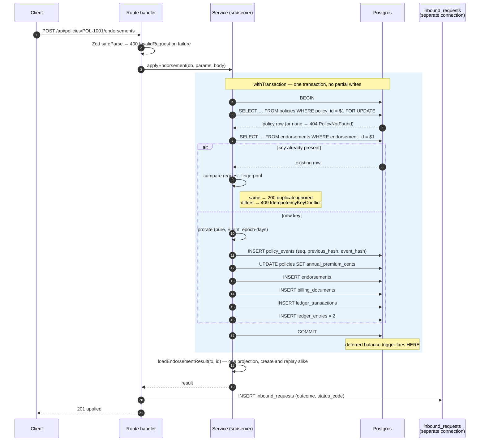
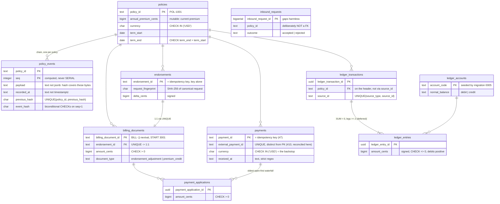

# Schema and transaction boundaries

Resolves [#9](https://github.com/angelguzmaning/policy-ledger-service/issues/9). Consolidates the
schema consequences of [#5](https://github.com/angelguzmaning/policy-ledger-service/issues/5)
(proration), [#6](https://github.com/angelguzmaning/policy-ledger-service/issues/6) (ledger),
[#7](https://github.com/angelguzmaning/policy-ledger-service/issues/7) (idempotency) and
[#8](https://github.com/angelguzmaning/policy-ledger-service/issues/8) (hash chain) into one DDL and
one write path.

## The identifier rule

> A primary key is the thing that names the row to whoever has to name it.

| Form                        | Applies when                                                                                                      | Tables                                                          |
| --------------------------- | ----------------------------------------------------------------------------------------------------------------- | --------------------------------------------------------------- |
| Caller-supplied natural key | The caller must be able to name the row — and for endorsements and payments the key _is_ the idempotency key (#7) | `policies`, `endorsements`, `payments`                          |
| Server-minted `uuid`        | Nobody outside the database ever names the row                                                                    | `ledger_transactions`, `ledger_entries`, `payment_applications` |
| Composite                   | Position _is_ identity                                                                                            | `policy_events (policy_id, seq)`                                |
| `bigserial`                 | Append-only log where gaps are harmless                                                                           | `inbound_requests`                                              |

`billing_documents` is the one case the rule does not settle alone: the caller names the document in
reads but never supplies it. It takes a server-minted natural key from a sequence, `START WITH 3001`,
so a fresh seed reproduces the brief's `BILL-3001` literally.

## Migrations

`migrations/NNNN_*.sql`, run by `scripts/migrate.ts` (#2): one transaction per file, `schema_migrations`
ledger, `pg_advisory_lock` around the run.

```
migrations/
  0001_policies_and_events.sql
  0002_endorsements_billing_and_payments.sql
  0003_ledger.sql
  0004_inbound_requests.sql
  0005_chart_of_accounts.sql
scripts/seed.ts                    <- POL-1001 + events.json
```

File order is foreign-key order, so the numbering documents the dependency graph.

**Migration or seed?** A _migration_ carries what the schema cannot function without; a _seed_ carries
what the brief handed us. The three `ledger_accounts` rows are an FK target — an enum that happens to
be stored as rows — so without them every financial write fails and a migrated database is a broken
one, not an empty one. They are `0005`. `POL-1001` and `events.json` are sample records the system
runs fine without, so they are `scripts/seed.ts`.

## DDL

### 0001 — policies and events

```sql
CREATE TABLE policies (
  policy_id             text PRIMARY KEY CHECK (policy_id ~ '^[A-Za-z0-9_-]{1,64}$'),
  homeowner_id          text        NOT NULL,
  status                text        NOT NULL CHECK (status IN ('active', 'cancelled', 'expired')),
  term_start            date        NOT NULL,
  term_end              date        NOT NULL,
  annual_premium_cents  bigint      NOT NULL CHECK (annual_premium_cents >= 0),
  currency              char(3)     NOT NULL CHECK (currency IN ('USD')),
  CHECK (term_end > term_start)
);
```

`policies.annual_premium_cents` is mutable — it is the _current_ premium, rewritten by each
endorsement. Append-only binds the ledger and the event chain, not this row, and #8's
`policy_created` event exists precisely so the current premium is recomputable from event 1 forward
rather than trusted here.

```sql
CREATE TABLE policy_events (
  policy_id      text     NOT NULL REFERENCES policies (policy_id),
  seq            integer  NOT NULL CHECK (seq >= 1),
  hash_version   integer  NOT NULL DEFAULT 1,
  event_type     text     NOT NULL CHECK (event_type IN
                            ('policy_created', 'endorsement_applied', 'payment_recorded')),
  recorded_at    text     NOT NULL CHECK (recorded_at ~
                            '^\d{4}-\d{2}-\d{2}T\d{2}:\d{2}:\d{2}\.\d{3}Z$'),
  payload        text     NOT NULL,
  previous_hash  char(64) CHECK (previous_hash ~ '^[0-9a-f]{64}$'),
  event_hash     char(64) NOT NULL CHECK (event_hash ~ '^[0-9a-f]{64}$'),

  PRIMARY KEY (policy_id, seq),
  UNIQUE (policy_id, previous_hash),
  CHECK ((seq = 1) = (previous_hash IS NULL)),
  CHECK ((seq = 1) = (event_type = 'policy_created'))
);
```

**`payload` is `text`, not `jsonb`.** `jsonb` reorders keys, drops duplicates and normalizes numbers —
it would silently rewrite the exact bytes the hash covers. #8's rule is _hash the bytes you stored_,
so the column holds the canonical serialization verbatim and a reviewer can reproduce `event_hash`
with `sha256sum`. The same reasoning already forced `recorded_at` to `text` rather than `timestamptz`.

The two biconditional CHECKs make a spliced chain head fail a _constraint_, not merely fail
verification. `UNIQUE (policy_id, previous_hash)` forbids a fork; genesis rows escape it only because
Postgres treats NULLs as distinct, and the primary key blocks a second `seq = 1` anyway.

```sql
CREATE FUNCTION refuse_mutation() RETURNS trigger LANGUAGE plpgsql AS $$
BEGIN
  RAISE EXCEPTION 'append-only: % on % is not permitted', TG_OP, TG_TABLE_NAME
    USING ERRCODE = 'restrict_violation';
END;
$$;

CREATE TRIGGER policy_events_append_only
  BEFORE UPDATE OR DELETE ON policy_events
  FOR EACH ROW EXECUTE FUNCTION refuse_mutation();
```

One shared function, four triggers (`policy_events`, `ledger_transactions`, `ledger_entries`,
`payment_applications`). No `TRUNCATE` guard — the test harness depends on `TRUNCATE`, and a control
you routinely disable protects nothing (#8).

### 0002 — endorsements, billing, payments

```sql
CREATE TABLE endorsements (
  endorsement_id                 text PRIMARY KEY
                                   CHECK (endorsement_id ~ '^[A-Za-z0-9_-]{1,64}$'),
  policy_id                      text     NOT NULL REFERENCES policies (policy_id),
  effective_date                 date     NOT NULL,
  previous_annual_premium_cents  bigint   NOT NULL CHECK (previous_annual_premium_cents >= 0),
  new_annual_premium_cents       bigint   NOT NULL CHECK (new_annual_premium_cents >= 0),
  delta_cents                    bigint   NOT NULL,
  reason                         text,
  request_fingerprint            char(64) NOT NULL CHECK (request_fingerprint ~ '^[0-9a-f]{64}$'),
  policy_seq                     integer  NOT NULL,
  applied_at                     timestamptz NOT NULL DEFAULT now(),

  FOREIGN KEY (policy_id, policy_seq) REFERENCES policy_events (policy_id, seq)
);
```

The primary key is `endorsement_id` **alone**, never `(policy_id, endorsement_id)` — #7's rule, so a
retry misrouted to another policy conflicts instead of duplicating.

```sql
CREATE SEQUENCE billing_document_number_seq START WITH 3001;

CREATE TABLE billing_documents (
  billing_document_id  text PRIMARY KEY
                         DEFAULT ('BILL-' || nextval('billing_document_number_seq')),
  policy_id            text        NOT NULL REFERENCES policies (policy_id),
  endorsement_id       text        NOT NULL UNIQUE REFERENCES endorsements (endorsement_id),
  document_type        text        NOT NULL CHECK (document_type IN
                                     ('endorsement_adjustment', 'premium_credit')),
  amount_cents         bigint      NOT NULL CHECK (amount_cents > 0),
  currency             char(3)     NOT NULL CHECK (currency IN ('USD')),
  due_date             date        NOT NULL,
  issued_at            timestamptz NOT NULL DEFAULT now()
);
```

`amount_cents > 0` survives because a negative delta becomes a `premium_credit` document rather than a
negative `endorsement_adjustment` (#5). There is **no `status` column** — status is derived from
`payment_applications` (#6), which is what lets nothing ever `UPDATE` a billing document.

```sql
CREATE TABLE payments (
  payment_id           text PRIMARY KEY CHECK (payment_id ~ '^[A-Za-z0-9_-]{1,64}$'),
  policy_id            text     NOT NULL REFERENCES policies (policy_id),
  external_payment_id  text     NOT NULL UNIQUE,
  amount_cents         bigint   NOT NULL CHECK (amount_cents > 0),
  currency             char(3)  NOT NULL CHECK (currency IN ('USD')),
  received_at          text     NOT NULL CHECK (received_at ~
                                  '^\d{4}-\d{2}-\d{2}T\d{2}:\d{2}:\d{2}Z$'),
  request_fingerprint  char(64) NOT NULL CHECK (request_fingerprint ~ '^[0-9a-f]{64}$'),
  policy_seq           integer  NOT NULL,
  recorded_at          timestamptz NOT NULL DEFAULT now(),

  FOREIGN KEY (policy_id, policy_seq) REFERENCES policy_events (policy_id, seq)
);

CREATE TABLE payment_applications (
  payment_application_id  uuid PRIMARY KEY DEFAULT gen_random_uuid(),
  payment_id              text        NOT NULL REFERENCES payments (payment_id),
  billing_document_id     text        NOT NULL REFERENCES billing_documents (billing_document_id),
  amount_cents            bigint      NOT NULL CHECK (amount_cents > 0),
  applied_at              timestamptz NOT NULL DEFAULT now(),

  UNIQUE (payment_id, billing_document_id)
);
```

`payments.currency CHECK (currency IN ('USD'))` is the claim to defend live: the wrong-currency
rejection is a `422` raised in the service _before_ the insert, and this constraint is the backstop
that refuses the row anyway if that check is ever removed or bypassed. The database refuses invalid
data even when the application has a bug.

`external_payment_id` is `UNIQUE` — **an addition inherited from #10, reconciled here.** `payment_id`
(the primary key) is delivery-retry identity: the idempotency key from #7. `external_payment_id` is a
second, independent fact — the upstream system's own identity for the payment — and the two coincide in
the sample data but are not the same column for a reason: without this constraint, the same real-world
payment redelivered under a fresh `payment_id` would insert as a brand-new row and debit `cash` a second
time with nothing to notice. The `UNIQUE` constraint is what `409 ExternalPaymentIdConflict` (#10) is
raised against; see ADR-0006 for the full reasoning and the rejected one-identifier alternative. The
inline `UNIQUE` gives the column its own index for free — no separate `CREATE INDEX` needed for the
`409` lookup path.

### 0003 — ledger

```sql
CREATE TABLE ledger_accounts (
  account_code    text PRIMARY KEY,
  account_type    text NOT NULL CHECK (account_type IN
                    ('asset', 'liability', 'equity', 'revenue', 'expense')),
  normal_balance  text NOT NULL CHECK (normal_balance IN ('debit', 'credit'))
);

CREATE TABLE ledger_transactions (
  ledger_transaction_id  uuid PRIMARY KEY DEFAULT gen_random_uuid(),
  policy_id              text        NOT NULL REFERENCES policies (policy_id),
  source_type            text        NOT NULL CHECK (source_type IN ('endorsement', 'payment')),
  source_id              text        NOT NULL,
  posted_at              timestamptz NOT NULL DEFAULT now(),

  UNIQUE (source_type, source_id)
);

CREATE TABLE ledger_entries (
  ledger_entry_id        uuid PRIMARY KEY DEFAULT gen_random_uuid(),
  ledger_transaction_id  uuid    NOT NULL REFERENCES ledger_transactions (ledger_transaction_id),
  account_code           text    NOT NULL REFERENCES ledger_accounts (account_code),
  amount_cents           bigint  NOT NULL CHECK (amount_cents <> 0),
  currency               char(3) NOT NULL CHECK (currency IN ('USD'))
);
```

`policy_id` sits on the transaction header, not reached through `source_id` (#6). Direction is the
sign of `amount_cents` — debits positive — so the invariant is `SUM = 0`, an account balance is a
`SUM`, and no `CASE` expression exists anywhere in schema, service or API.

```sql
CREATE FUNCTION assert_transaction_balanced() RETURNS trigger LANGUAGE plpgsql AS $$
DECLARE
  total bigint;
  legs  integer;
BEGIN
  SELECT COALESCE(SUM(amount_cents), 0), COUNT(*)
    INTO total, legs
    FROM ledger_entries
   WHERE ledger_transaction_id = NEW.ledger_transaction_id;

  IF total <> 0 OR legs < 2 THEN
    RAISE EXCEPTION 'unbalanced ledger transaction %: sum=%, legs=%',
      NEW.ledger_transaction_id, total, legs
      USING ERRCODE = 'integrity_constraint_violation';
  END IF;
  RETURN NULL;
END;
$$;

CREATE CONSTRAINT TRIGGER ledger_entries_balanced
  AFTER INSERT ON ledger_entries
  DEFERRABLE INITIALLY DEFERRED
  FOR EACH ROW EXECUTE FUNCTION assert_transaction_balanced();
```

Deferral is load-bearing: legs are inserted one at a time, so an immediate trigger would reject every
valid write. A transaction gives atomicity, not correctness — a sign or rounding bug commits
atomically and wrongly — and `CHECK` is per-row, so it structurally cannot express a cross-row sum.

### 0004 — inbound requests

```sql
CREATE TABLE inbound_requests (
  inbound_request_id  bigserial PRIMARY KEY,
  policy_id           text,
  request_kind        text        NOT NULL CHECK (request_kind IN ('endorsement', 'payment')),
  business_id         text,
  outcome             text        NOT NULL CHECK (outcome IN ('accepted', 'rejected')),
  status_code         integer     NOT NULL,
  error_code          text,
  request_body        text        NOT NULL,
  received_at         timestamptz NOT NULL DEFAULT now()
);
```

**`policy_id` deliberately has no foreign key.** A request naming a policy that does not exist is
exactly the kind that must still be recorded; an FK here would refuse to log the `404`. This is a
receipt log, not part of the auditable core, which is also why it carries no append-only trigger.

### 0005 — chart of accounts

```sql
INSERT INTO ledger_accounts (account_code, account_type, normal_balance) VALUES
  ('cash',                'asset',   'debit'),
  ('premium_receivable',  'asset',   'debit'),
  ('written_premium',     'revenue', 'credit');
```

### Read-path indexes

```sql
CREATE INDEX ON endorsements          (policy_id);
CREATE INDEX ON payments              (policy_id);
CREATE INDEX ON ledger_transactions   (policy_id);
CREATE INDEX ON ledger_entries        (ledger_transaction_id);
CREATE INDEX ON payment_applications  (billing_document_id);

-- the payment waterfall's ORDER BY, exactly (#6)
CREATE INDEX ON billing_documents (policy_id, due_date, issued_at, billing_document_id);
```

`policy_events` needs none: `PRIMARY KEY (policy_id, seq)` already serves both the per-policy history
read and the tip lookup.

## Transaction boundaries

`READ COMMITTED` — the Postgres default — with `SELECT … FOR UPDATE` on the policy row as the
transaction's **first statement**. The lock, not the isolation level, is what closes the concurrent
endorsement race, the forked hash chain, the ordering check and the idempotency race: every writer for
a policy takes the same lock before reading anything. There is no serialization-failure retry loop, so
no code path exists that runs only under contention.

### Plumbing

```ts
type Db = Pool
type Tx = PoolClient & { readonly __tx: unique symbol }

export async function withTransaction<T>(db: Db, fn: (tx: Tx) => Promise<T>): Promise<T> {
  const client = await db.connect()
  try {
    await client.query('BEGIN')
    const result = await fn(client as unknown as Tx)
    await client.query('COMMIT')
    return result
  } catch (error) {
    await client.query('ROLLBACK')
    throw error
  } finally {
    client.release()
  }
}
```

`Db` and `Tx` are distinct types. A function that must run inside a transaction takes `Tx`, so handing
it a pool does not compile; read-only helpers take `Db | Tx`. `withTransaction` is called from exactly
one layer — the route handler — and is the only place that names `BEGIN`. Nesting is therefore
unreachable by construction rather than by convention, and `release()` in `finally` runs on every path.

### The endorsement write path

Validation happens **before** `BEGIN`: Zod `strictObject` + `safeParse` on path params and body, so a
malformed request never opens a transaction.



The receipt on the separate connection is written on **every** outcome, accepted or rejected — that is
the whole point of putting it outside the business transaction. The payment path is the same shape:
lock, idempotency check, currency validation, `INSERT payments`, waterfall application into
`payment_applications`, ledger transaction, policy event, commit.

### Error translation

Translation happens at the SQL edge, inside `src/server`, so no `pg` error reaches a route handler.

| Postgres                                     | Meaning                                               | Becomes                                                                           |
| -------------------------------------------- | ----------------------------------------------------- | --------------------------------------------------------------------------------- |
| `23505` on `endorsements` / `payments` PK    | Concurrent insert of the same business id             | Re-read under the lock and resolve as duplicate or conflict — never surfaced (#7) |
| `23503` foreign key                          | A referenced policy vanished                          | `404 PolicyNotFound`                                                              |
| `23514` check violation                      | An invariant the service should have enforced         | `500` — this is a bug, not a client error                                         |
| `restrict_violation` from `refuse_mutation`  | Something tried to `UPDATE`/`DELETE` append-only data | `500`                                                                             |
| `integrity_constraint_violation` at `COMMIT` | Deferred balance trigger rejected the transaction     | `500 LedgerUnbalanced`                                                            |

## The atomicity proof

After the wrong-currency `PAY-9002` is rejected, nothing financial exists and the receipt does. The
test asserts both halves at once, over **every** table, with the table list read from the live schema
so a table added later is covered without touching the test:

```ts
async function countAllTables(db: Db): Promise<Record<string, number>> {
  const { rows } = await db.query<{ table_name: string }>(`
    SELECT table_name FROM information_schema.tables
     WHERE table_schema = 'public' AND table_type = 'BASE TABLE'
       AND table_name <> 'schema_migrations'`)
  const counts: Record<string, number> = {}
  for (const { table_name } of rows) {
    const {
      rows: [row],
    } = await db.query<{ n: string }>(`SELECT COUNT(*) AS n FROM ${table_name}`)
    counts[table_name] = Number(row?.n ?? 0)
  }
  return counts
}

const before = await countAllTables(db)
const response = await postPayment('POL-1001', PAY_9002_EUR)
expect(response.status).toBe(422)

expect(await countAllTables(db)).toEqual({
  ...before,
  inbound_requests: before.inbound_requests + 1,
})
```

It proves nothing exists _anywhere_, not that nothing exists in the three tables the author remembered
to check. `countAllTables` belongs in the shared test fixtures, not in this one test.

**Binding on the test harness (#3):** the `TRUNCATE … RESTART IDENTITY CASCADE` list must **exclude
`ledger_accounts`**. Truncating `ledger_entries` does not touch its FK parent, but naming
`ledger_accounts` with `CASCADE` would wipe the chart of accounts and every financial write after it
would fail.

## Entity-relationship diagram



`inbound_requests` stands apart on purpose: it references nothing, so it can record a request for a
policy that does not exist.

## Known limitations

| Limitation                                                                                              | How you would notice                                     | What you would do                                                                                                                         |
| ------------------------------------------------------------------------------------------------------- | -------------------------------------------------------- | ----------------------------------------------------------------------------------------------------------------------------------------- |
| `BILL-` numbers have gaps — `nextval` is non-transactional, so a rolled-back endorsement burns a number | A gap in `billing_document_id` when read in order        | Nothing. No invariant reads them in order; the sequence is an identifier source, not a counter of documents                               |
| Single-currency by constraint — `CHECK (currency IN ('USD'))` on four tables                            | A multi-currency requirement arrives and inserts fail    | Migration widening the CHECK plus a currency dimension on the ledger; the constraint fails loudly rather than storing mixed-currency sums |
| `READ COMMITTED` protects only because every writer takes the policy lock first                         | A future write path that forgets the lock races silently | The lock is taken inside `withTransaction`'s single call site pattern; a new mutation not going through it is visible in review           |
| Whole-table `COUNT(*)` in `countAllTables` scans every table                                            | Slow tests as data grows                                 | Fine at test scale; it is a fixture, never production code                                                                                |
| `inbound_requests` grows without bound and has no retention policy                                      | Table size in the on-call dashboard                      | Time-based partitioning or a retention job; out of scope for the challenge                                                                |
| A rejected request's body is stored verbatim in `inbound_requests`                                      | Sensitive data in the log                                | The brief's payloads carry no PII beyond ids; a production version would redact before writing                                            |
